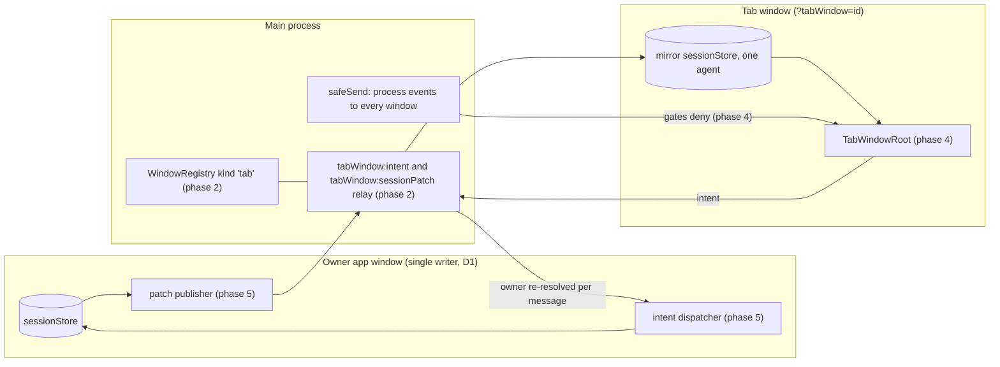

# Tab Windows (maintainer guide)

A tab window is an ordinary OS window that holds one agent's popped-out tabs and nothing else: a slim header with the agent name, a tab strip, and the active tab's content. It is a view. The app window that owns the agent (the primary, or the secondary it was moved to) stays the only writer of that agent's `Session` and the only runner of its one-time side effects. The owner streams the agent's state to the tab window as patches, and the tab window sends every user action back as an intent that the owner runs through the same function its own UI calls. The main-process `WindowRegistry` holds the truth of which tab is popped into which window (a new `'tab'` window kind, one per agent). The owner keeps a popped tab in its tab arrays and in `unifiedTabOrder`, hides it from its own strip and tab-picking math, and sends any navigation that targets it to the tab window. Closing a tab window docks its tabs. Tab windows survive a restart. The feature exists only in the Electron desktop build.

Status: phase 4 (renderer shell) in progress. The spec is `TAB-WINDOWS-SPEC.md` in the `2026-09-30-Tab-Windows` playbook folder. Requirement IDs (TW-n) and decisions (Dn) below refer to it. Line numbers are as of `c3cd1d2e1b` (`origin/rc`, 2026-10-18). When they drift, search by symbol.

## Requirements

Copied from the spec.

| ID    | Requirement                                                                                                                                                                                                                       |
| ----- | --------------------------------------------------------------------------------------------------------------------------------------------------------------------------------------------------------------------------------- |
| TW-1  | A "tab window" is an ordinary OS window (resizable, movable to any display, normal z-order). No always-on-top, no frameless HUD.                                                                                                  |
| TW-2  | A tab window has NO Left Bar and NO Right Bar. It shows a slim header, a tab strip, and the active tab's content.                                                                                                                 |
| TW-3  | The header and the OS window title contain the agent's name (for example `Maestro Marketing - Tab Window`). The title follows a rename of the agent.                                                                              |
| TW-4  | One tab window per agent. When a second tab of the SAME agent is popped out, it joins that agent's existing tab window.                                                                                                           |
| TW-5  | Tabs of DIFFERENT agents never share a tab window. Each agent gets its own.                                                                                                                                                       |
| TW-6  | Inside a tab window, the user switches tabs exactly as anywhere else: click a chip, `Cmd+Shift+[` / `Cmd+Shift+]`, `Cmd+1..9`, the same tab shortcuts and chip menus.                                                             |
| TW-7  | AI tabs are the primary target and must work fully (transcript streaming, composer, queue, Stop, thinking pill, model/effort/thinking controls, permission prompts). Terminal, file preview, and browser tabs are also supported. |
| TW-8  | A popped-out tab leaves the main window's tab strip. Docking it returns it to its previous position in the agent's tab order.                                                                                                     |
| TW-9  | Closing a tab window DOCKS its tabs back into the main window. It never closes or destroys a tab or its transcript.                                                                                                               |
| TW-10 | Tab windows persist across an app restart: same agent, same tabs, same bounds and display (clamped on screen if that display is gone).                                                                                            |
| TW-11 | Three ways in (shortcut, Cmd+K command, tab chip menu item) and two ways out (Dock button in the tab window, closing the window).                                                                                                 |
| TW-12 | CLI parity: `maestro-cli tab pop-out <tab-id>`, `maestro-cli tab dock <tab-id>`, and a read verb that lists tab windows and their tabs. Same code path as the UI.                                                                 |
| TW-13 | Not offered in the web-desktop (browser) build: a browser client has no OS windows.                                                                                                                                               |
| TW-14 | Hidden consult tabs (`isAiTabHidden`) cannot be popped out.                                                                                                                                                                       |

## D1. The agent keeps one owner

### Where ownership lives today

| Layer              | Symbol                                                                                                                                                                                                                                              | File                                                       |
| ------------------ | --------------------------------------------------------------------------------------------------------------------------------------------------------------------------------------------------------------------------------------------------- | ---------------------------------------------------------- |
| Main truth         | `RegisteredWindow.sessionIds`, `getWindowForSession()` (:171), `registerSession()` (:308), `moveSession()` / `applyMove()` (:247 / :267), `reclaimSessionsToPrimary()` (:334)                                                                       | `src/main/window-registry.ts`                              |
| Renderer predicate | `WindowContext.ownsSession` (:403): the primary owns every agent no secondary claims (`!sessionsOwnedElsewhere.has(id)`), a secondary owns its `scope.sessionIds`                                                                                   | `src/renderer/contexts/WindowContext.tsx`                  |
| Event broadcast    | `safeSend = createSafeSend(() => BrowserWindow.getAllWindows())` (:540). Every `process:*` event reaches every window, tab windows included. The rule is the MULTI-WINDOW INVARIANT in `src/main/utils/safe-send.ts`.                               | `src/main/index.ts`                                        |
| Render gate        | `useOwnedSessionGate()` (:60), keyed by `agentIdFromProcessSessionId()` (:44)                                                                                                                                                                       | `src/renderer/hooks/agent/internal/useOwnedSessionGate.ts` |
| Side-effect gate   | `useOwnedSideEffectGate()` (:95)                                                                                                                                                                                                                    | same file                                                  |
| Persistence        | `useDebouncedPersistence(initialLoadComplete)` mounted once in `App.tsx` (:2202) writes `sessions:setMany`. Main tells every other window through `broadcastSessionLifecycle()` (`sessions:lifecycleSync`, `src/main/ipc/handlers/persistence.ts`). |                                                            |

The one-time side effects D1 protects run behind `useOwnedSideEffectGate`: `useAgentExitListener` (History entry, synopsis, stats row, git refresh, queue dequeue), `useAgentErrorListener`, `useAgentDataListener`, `useAgentSessionIdListener`, `useAgentStderrListener`, `useAgentToolExecutionListener`, `useAgentThinkingListener`, `useAgentClaudeModeResolvedListener`, `useAgentCommandExitListener` (all in `src/renderer/hooks/agent/internal/`), `useQueueProcessing`, and `useSessionTranscriptSync`. The render gate guards `useAgentUsageListener`, `useAgentUserInputListener`, `useAgentSshRemoteListener`, `useAgentSlashCommandsListener`, `useSteeringVerdictListener`, `useThoughtStreamToolListener`, `useThoughtStreamCaptureListener`, `useSessionRestoration`, and `useThroughputCapture` (the throughput gauge).

### How a tab window could become a second writer, and the guard for each

> [!WARNING]
> Each of these is live in the code today. A tab window built without the guard breaks D1 silently.

| #   | Trap                                                                                                                                                                                                                                                                                                                                                | Guard (phase)                                                                                                                                                                                                                                                                                                                                                                                  |
| --- | --------------------------------------------------------------------------------------------------------------------------------------------------------------------------------------------------------------------------------------------------------------------------------------------------------------------------------------------------- | ---------------------------------------------------------------------------------------------------------------------------------------------------------------------------------------------------------------------------------------------------------------------------------------------------------------------------------------------------------------------------------------------- |
| 1   | `windows:registerSession` resolves the CALLING window with `resolveCallingWindow()` (`src/main/ipc/handlers/windows.ts:99`, uses `getAll()`). A tab window that calls it claims the agent.                                                                                                                                                          | Refuse non-`app` kinds in the handler and in `WindowRegistry.registerSession` (2).                                                                                                                                                                                                                                                                                                             |
| 2   | `windows:moveSession(sessionId, from, to)` accepts any window id, and `applyMove` pushes the agent into the destination's `sessionIds`. A tab window id as destination makes it an owner.                                                                                                                                                           | Refuse non-`app` destinations in `moveSession` / `applyMove` and `setSessionsForWindow` (2).                                                                                                                                                                                                                                                                                                   |
| 3   | `WindowProvider` decides `isMainWindow` from the ABSENCE of `?windowId=` (`readWindowIdParam()`, WindowContext.tsx:52 and :242). A tab window loaded with `?tabWindow=<id>` that mounts `WindowProvider` believes it is the primary catch-all owner.                                                                                                | `TabWindowRoot` does not mount `WindowProvider`. Read window identity through `isTabWindow()` (4).                                                                                                                                                                                                                                                                                             |
| 4   | Both gates permit everything outside a `WindowProvider`, and their ref starts as `() => true` before the effect commits.                                                                                                                                                                                                                            | In a tab window both gates answer false from the first event, the initial ref value included (4).                                                                                                                                                                                                                                                                                              |
| 5   | The tab window's `sessionStore` is a mirror whose non-popped tabs have `logs: []`. Any persistence there writes emptied transcripts to disk.                                                                                                                                                                                                        | Never mount `useDebouncedPersistence`, `useSessionRestoration`, `useSessionLifecycleSync`, `useSessionTranscriptSync`, or the `useAgentListeners` family in a tab window. The other direct `window.maestro.sessions.setMany` callers (`useHostBrowserRelayResponder`, `useAppRemoteEventListeners`, `services/cueBundle.ts`, `services/providerTranslation.ts`) must not run there either (4). |
| 6   | `broadcastSessionLifecycle()` sends `sessions:lifecycleSync` to every `BrowserWindow`.                                                                                                                                                                                                                                                              | The tab window ignores it. Its only state source is the owner's patches (4, 5).                                                                                                                                                                                                                                                                                                                |
| 7   | Reused components that write the store directly (`updateSessionWith`, `updateAiTab`, `setSessions`, `useTabStore` actions) write the mirror, which then diverges from the owner. Example: `MainPanelContent` runs `normalizeTabGroups` against the active session (MainPanelContent.tsx:540-551). It is harmless only while the result is identity. | Audit every reused component for direct store writes and route each one through an intent (4, 5).                                                                                                                                                                                                                                                                                              |

## D2. The tab window is a view plus an intent sender

### Precedent: Quick Chat

Quick Chat already renders a view in one window while the conversation runs in the owner app window. The tab window relay copies its shape.

| Piece                    | Quick Chat                                                                                                                                                                                                                                          | Tab window equivalent                                                                 |
| ------------------------ | --------------------------------------------------------------------------------------------------------------------------------------------------------------------------------------------------------------------------------------------------- | ------------------------------------------------------------------------------------- |
| Owner lookup per message | `resolveEngineWindow()` in `createQuickChatController` (`src/main/quick-chat/quick-chat-controller.ts`) calls `getWindowForSession(agentId)` on every command                                                                                       | `tabWindow:intent` resolves the current owner from the registry on every message (D7) |
| Request and reply        | `requestFromRenderer(win, 'quickChat:command', { args, timeoutMs, fallback })` (`src/main/web-server/callbacks/remoteRequest.ts`)                                                                                                                   | same helper, channel `tabWindow:intent`                                               |
| Owner listener           | preload `quickChat.onCommand()` (`src/main/preload/quickChat.ts`) replies on the per-request channel. `useQuickChatEngine()` is mounted once in `App.tsx` (:2099) and starts `startQuickChatEngine()` (`src/renderer/services/quickChatEngine.ts`). | an intent handler hook mounted once in `App.tsx`                                      |
| State to the view        | the engine sends `quickChat:snapshot`; main forwards it to the floating window (`pushSnapshotToWindow`)                                                                                                                                             | owner sends `tabWindow:sessionPatch`; main forwards it to the agent's tab window      |

### How a reduced window boots today (`src/renderer/main.tsx`)

Every window loads the same `index.html` and bundle, and the URL query picks what mounts. The `?tabWindow=<id>` branch (phase 4) is a third reduced branch beside these two.

1. Before the body parses, `src/renderer/public/window-mode.js` (a classic script in `<head>`, kept external because the CSP allows no inline scripts) reads the query. It tags `<html>` with `quick-chat-window` or `cadenza-hud`, so the inline CSS in `index.html` hides `#initial-splash` from the first paint.
2. `main.tsx` runs the parts every window shares: Sentry init and the global `error` / `unhandledrejection` handlers (:18-109).
3. It reads `isCadenzaHud = new URLSearchParams(window.location.search).has('cadenzaHud')` (:114) and `isQuickChat` the same way (:118).
4. It mounts one of three roots, each in `React.StrictMode` and an `ErrorBoundary`:

   | Query         | Lines    | What `main.tsx` does                                                                                                                              |
   | ------------- | -------- | ------------------------------------------------------------------------------------------------------------------------------------------------- |
   | `?quickChat`  | :120-130 | Tags `html` and `body`, removes `#initial-splash`, renders `<QuickChatRoot />`                                                                    |
   | `?cadenzaHud` | :131-143 | The same, with `<CadenzaHudRoot />` (`src/renderer/cadenzaHud.tsx`)                                                                               |
   | anything else | :144-156 | The full app: `<LayerStackProvider><WizardProvider><MaestroConsole /></WizardProvider></LayerStackProvider>`, where `MaestroConsole` is `App.tsx` |

A reduced root never mounts `App.tsx`, so none of the app-wide hooks run in it: the `process:*` listeners, persistence, remote integration, the main keyboard handler, and `WindowProvider`. That absence is what keeps a reduced window from becoming a writer (D1).

Each reduced root brings its own basics instead. `QuickChatRoot` (`src/renderer/quickChat/QuickChatRoot.tsx`) mounts its own `LayerStackProvider`, calls `useWindowSettingsSync()` (`src/renderer/hooks/settings/useWindowSettingsSync.ts`: settings, theme, and typography for a renderer that does not run `useSettings`), and hosts `ZoomViewerHost`. Phase 4 adds `isTabWindow()` beside `isWebDesktop()` in `src/renderer/utils/runtimeContext.ts`, so window identity is never parsed from the URL a second time.

### Patch rules, checked against the code

- Log entries are replaced, never mutated. A streamed chunk becomes `{ ...lastLog, text: lastLog.text + data }` inside a new array (`useBatchedSessionUpdates.ts`, the `aiTabLogs` flush around :262-330). Comparing entry identity finds the splice.
- The same flush also DROPS earlier `thinking` and `tool` entries when assistant text arrives, unless `showThinking === 'sticky'` (:271-276). `useTranscriptBackfill` prepends older history. So the first changed index `i` can be anywhere, including 0. Applying a patch means: keep `[0, i)`, then replace everything after it with the sent `next.slice(i)`. It never just appends.
- Tool output is already capped by `compactToolOutput()` / `compactSessionToolOutputs()` (`src/shared/toolOutput.ts`).
- Per-window fields: `clientFields` in `src/shared/sessionPersistenceMerge.ts` (`activeTabId`, `activeFileTabId`, `activeBrowserTabId`, `activeTerminalTabId`, `activeGroupId`, `inputMode`, `inputValue`, `commandMode`, `stagedImages`, `terminalDraftInput`, `ptyInitialized`) are per client by design.
  - The tab window owns its own values for these. Owner deltas never overwrite them.
  - Its active pointers come from the registry's `activeTabRef`. Components read `getActiveTab(session)`, so the mirror's `activeTabId` must always be the tab window's active AI tab. Never the owner's: that tab's logs are emptied in the mirror.
  - The draft fields follow the draft rule below.
- `liveFields` in the same file (`state`, `busySource`, `thinkingStartTime`, `currentCycleTokens`, `agentError`, ...) ride every patch along with `name` and the model settings.

### Side channels the AI tab view needs besides `Session`

The AI tab components also read per-window stores, which are empty in a fresh tab window. Phase 5 picks one of three for each: mirror it in the patch, recompute it in the tab window, or accept a reduced view (and write it down).

| Source                                                                                                                                                    | What renders from it                                      | Notes                                                                                                                                                                                                                                                                                                                                                                                                                                                    |
| --------------------------------------------------------------------------------------------------------------------------------------------------------- | --------------------------------------------------------- | -------------------------------------------------------------------------------------------------------------------------------------------------------------------------------------------------------------------------------------------------------------------------------------------------------------------------------------------------------------------------------------------------------------------------------------------------------- |
| Permission requests: `permissionRequestStore` + `PermissionPrompt` (mounted once in `AppShell`)                                                           | allow/deny prompt, AskUserQuestion picker                 | Main sends every request to the PRIMARY window only: `initPermissionRelay(getMainWindow, ...)` (`src/main/permission-relay/integration.ts:35`). A `PermissionRequest` carries `sessionId` and `tabId`. The answer goes straight to main by `requestId` (`permission:respond`) and writes no `Session`, so it is not an intent. Route the request to the tab window when the tab is popped. Note that `respond` clears only the answering window's queue. |
| `retryStore` (`useRetryStatus`, `useIsHeldRetryItem`)                                                                                                     | outage card, compaction card, held badge, chip outage dot |                                                                                                                                                                                                                                                                                                                                                                                                                                                          |
| `aiCommandStore`                                                                                                                                          | AI command proposal card                                  | Run `requestAiCommand()` in the tab window (it writes no `Session`, see table A)                                                                                                                                                                                                                                                                                                                                                                         |
| `autoRunSteeringStore`, `useBackgroundAutoRuns`, batch run state                                                                                          | Auto Run rows in `ThinkingStatusPill`                     |                                                                                                                                                                                                                                                                                                                                                                                                                                                          |
| App state in `useSessionRecovery` / `useSummarizeAndContinue` / `useMergeSession`, `operationStore`                                                       | recovery card, summarize and merge progress overlays      |                                                                                                                                                                                                                                                                                                                                                                                                                                                          |
| `crossAgentInFlightStore`                                                                                                                                 | consult indicators                                        |                                                                                                                                                                                                                                                                                                                                                                                                                                                          |
| `throughputGaugeStore` (filled by `useThroughputCapture`, render-gated)                                                                                   | throughput gauge                                          | Shows nothing once the gate denies (phase 4) unless mirrored                                                                                                                                                                                                                                                                                                                                                                                             |
| `composerInputStore`, `liveDraftStore`, `messageGistStore`, `uiStore.editingQueuedItemId`, `contextTimelineStore`, `modalStore`, `useImageAnnotatorStore` | per-window UI                                             | Local to the tab window by design                                                                                                                                                                                                                                                                                                                                                                                                                        |

### Unread marking (trap)

`useAgentDataListener` marks a tab unread when it is not the owner's active tab: `shouldMarkUnread = !isTargetTabActive || !isThisSessionActive || !isUserAtBottom` (`src/renderer/hooks/agent/internal/useAgentDataListener.ts`, around :160-166). `useSessionTranscriptSync` repeats the same rule. A popped tab is never the owner's active tab (D4), so every chunk would set `hasUnread` while the user is watching it in the tab window.

The owner needs a "viewed in its tab window" signal for each popped tab: active in its tab window, window visible, and `isAtBottom`. The tab window reports it by intent (`setViewState` below), and both unread rules must honor it.

### Target threading (trap)

Most owner handlers decide which agent and tab to act on at call time, from the owner's ACTIVE session and tab, not from arguments. A popped tab is never the owner's active tab, so calling them unchanged acts on the wrong tab. The fix is always the same function with an explicit target added (the default stays the active one), never a copy. Verified active-bound code:

- `processInput` (`src/renderer/hooks/input/useInputProcessing.ts`). `ProcessInputOptions` (:228) already takes `sessionId`, `tabId`, `images`, `forceParallel`, `hold`, and `steer`. However:
  - Text, command mode, and images default to the owner's `composerInputStore` and active tab.
  - The command-mode branch uses `getActiveTab(activeSession)` and `syncAiInputToSession('')` without a target.
  - `clearComposer` (:695) clears the owner's composer.
  - Passing `overrideInputValue` skips the repeat-submit guard, the early composer clear, and `@mention` planning.
- The model, effort, and scroll setters `useTabStore.setTabModel` / `setTabEffort` / `setAiTabScrollTop` / `setAiTabAtBottom` all go through the private `updateAiTab(tabId, updates)` (`src/renderer/stores/tabStore.ts:460`). It writes only when the tab is in the ACTIVE session, so for any other agent it silently does nothing. The file-tab setters share the same problem through the private `updateFileTab`. The explicit alternatives are `updateAiTab(sessionId, tabId, fn)` and `updateFileTab(sessionId, tabId, fn)` in `src/renderer/stores/sessionStore.ts`.
- `handleInterrupt()` (`src/renderer/hooks/agent/useInterruptHandler.ts`) takes no arguments.
- `useAITabHandlers` (`src/renderer/hooks/tabs/internal/useAITabHandlers.ts`): `handleTabSelect`, `handleTabClose` / `performTabClose`, `handleTabStar`, `handleTabMarkUnread`, `handleToggleTabSaveToHistory`, `handleToggleTabShowThinking`, `handleToggleTabEnterToSend`.
- `useScrollLogHandlers`: `handleDeleteLog`, `handleScrollPositionChange`, `handleAtBottomChange`.
- The `useForkConversation()` callback, `handleSummarizeAndContinue(tabId?)`, `handleRenameTab(newName)` (active session plus the modal's `renameTabId`), `handleAutoNameTab()`, and `useTabExportHandlers`.
- `useMergeTransferHandlers.handleMergeWith` / `handleOpenSendToAgentModal` also focus the tab in the owner first, which breaks D4 for a popped tab.
- The App.tsx inline queue handlers pin `activeSessionIdRef.current`: `handleRemoveQueuedItem`, `handleToggleQueuedItemPause`, `handleMergeQueuedItem`, `handleEditQueuedItem`, `handleReorderQueuedItem`, `handleForceSendQueuedItem`, `handleSteerQueuedItem` (App.tsx :1814-1850 and :2636-2658). The services under them already take `sessionId`.
- Some actions are window events that only the window that raised them hears: `HOLD_SEND_EVENT`, `FORCED_PARALLEL_SEND_EVENT` and `STEER_SEND_EVENT` (`useInputKeyDown`), `maestro:triggerForceSendQueued`, `maestro:codexFollowup`, `maestro:in-app-deep-link`, `maestro:refreshFileTree`.
- Some module state exists only in the window that started the work: the shell `activeRuns` map (`services/shellCommand.ts`, needed by `cancelShellCommand`), `steersInFlight` (`services/chatSteering.ts`), `composerSubmitsInFlight` (`useInputProcessing.ts:109`), and the retry timers in `retryStore`.

`PaneChatActions` and `PaneTabActions` in `src/renderer/components/MainPanel/TiledLayout.tsx` are the existing bundles of AI chat and tab handlers for a tiled pane. Their doc comment states the same limit: each handler is "addressed by id ... or keyed to the session's ACTIVE AI tab".

### The intent union

Rules for `TabWindowIntent` (`src/shared/tabWindowTypes.ts`, phase 2):

- Every intent carries `agentId` and the target tab ref.
- The owner dispatcher re-resolves the session from its own store. If the agent is no longer its own, it refuses (the next message goes to the new owner, D7).
- Confirmations run in the tab window, which hosts its own modals. The intent carries only the confirmed action.
- Rows marked "local" need no intent: they write no `Session` field and start no process.
- The owner-side function is what the owner's own UI reaches today. "Explicit target" means the target-threading refactor above.
- The `kind` names are final as of phase 2 (`TabWindowIntentPayloads` holds each payload). The table C "navigation" row is `focusInOwner { targetTabRef }`. `UnifiedTabRef` now lives in `src/shared/unifiedTabRef.ts` (with `SingleTabRef`, `isSingleTabRef`, `isSameTabRef`); the renderer re-exports it.

#### A. Composer (`InputArea` and its subcomponents)

| `kind`                                                  | UI                                                                                                                                                                                                                                                                                                                                  | Payload                                                                                        | Owner-side function                                                                                                                                                                                | Notes                                                                                                                                                                                                                                                              |
| ------------------------------------------------------- | ----------------------------------------------------------------------------------------------------------------------------------------------------------------------------------------------------------------------------------------------------------------------------------------------------------------------------------- | ---------------------------------------------------------------------------------------------- | -------------------------------------------------------------------------------------------------------------------------------------------------------------------------------------------------- | ------------------------------------------------------------------------------------------------------------------------------------------------------------------------------------------------------------------------------------------------------------------ |
| `send`                                                  | Enter (`InputTextarea` then `useInputKeyDown`), send button (`NotificationSendControls`; phone `ToolbarControls`), Send menu Queue and Queue Held (`SendMenuPopover`), Prompt Composer send (`handlePromptComposerSend`), wizard send (`WizardInputPanel`), Force Send with a draft (`forceParallel`), Steer with a draft (`steer`) | `text`, `images`, `commandMode`, `mentionRoutingOverride`, `forceParallel?`, `hold?`, `steer?` | `processInput(text, { sessionId, tabId, images, forceParallel, hold, steer })`, explicit target, extended to take `commandMode` and `mentionRoutingOverride` and to plan `@mentions` for this text | One path covers idle dispatch, busy queueing, `!` shell (`dispatchShellCommand`), slash commands (custom, agent, `/history`, `/wizard`, `/skills`), the `@mention` plan, tab auto-naming, and the wizard branch. See DV1.                                          |
| local                                                   | AI command mode send                                                                                                                                                                                                                                                                                                                |                                                                                                | `requestAiCommand({ session, tabId, request })` (`services/aiCommand.ts:31`) runs IN the tab window                                                                                                | Writes only `aiCommandStore` and calls `window.maestro.aiCommand.suggest`. It reads the tab's transcript from the mirror.                                                                                                                                          |
| `runShellCommand`                                       | AI command proposal Run, `Y`, Enter on Run (`AiCommandProposal`)                                                                                                                                                                                                                                                                    | `command`, `request`                                                                           | `acceptAiCommand` then `dispatchShellCommand({ session, tabId, command, request })` (`services/shellCommand.ts:293`)                                                                               | The tab window clears its own proposal.                                                                                                                                                                                                                            |
| local                                                   | proposal Cancel, Esc, `N`                                                                                                                                                                                                                                                                                                           |                                                                                                | `dismissAiCommand(entry)` (`aiCommand.ts:124`) returns the request to the local composer                                                                                                           |                                                                                                                                                                                                                                                                    |
| `setDraft`                                              | typing; paste, drop, and attach images; `@` and slash accept; tab completion; voice dictation; staged image remove, annotate, and reorder (with `Screenshot N` renumbering); transcript "Quote in Message"                                                                                                                          | `inputValue`, `commandMode`, `stagedImages`                                                    | `updateAiTab(sessionId, tabId, fn)` (sessionStore) writing the fields `writeDraftToTab` (`hooks/input/useInputSync.ts:131`) writes. `commandMode` goes through `normalizeComposerCommandMode`.     | Debounce like `DRAFT_FLUSH_DELAY_MS` (300 ms). Flush on dock, on blur, and when the window hides. `handlePaste` / `handleDrop` take DOM events and read files with FileReader, so they run in the tab window. Skip `syncFileTreeToTabCompletion` (no Files panel). |
| `setModel`                                              | model pill and typed model id (`ModelEffortPills`), phone sheet (`ComposerOptionsSheet`), `ModelEffortModal` (Alt+Cmd+.)                                                                                                                                                                                                            | `model?`                                                                                       | `useTabStore.setTabModel(tabId, model)`, explicit target                                                                                                                                           |                                                                                                                                                                                                                                                                    |
| `setEffort`                                             | effort pill, phone sheet, `ModelEffortModal`                                                                                                                                                                                                                                                                                        | `effort?`                                                                                      | `useTabStore.setTabEffort(tabId, effort)`, explicit target                                                                                                                                         |                                                                                                                                                                                                                                                                    |
| `setPermissionMode`                                     | permission pill (desktop cycles with `nextPermissionMode`), phone sheet                                                                                                                                                                                                                                                             | `mode`                                                                                         | `updateSessionWith` with `permissionModeFields(mode)` (`utils/tabHelpers/focusFields.ts:70`), as `ToolbarControls.handlePermissionModeChange` does                                                 | Writes `permissionMode` and `readOnlyMode`.                                                                                                                                                                                                                        |
| `toggleReadOnly`                                        | Cmd+R, Prompt Composer                                                                                                                                                                                                                                                                                                              |                                                                                                | `toggleReadOnlyModeFields(tab)` (`focusFields.ts:50`)                                                                                                                                              |                                                                                                                                                                                                                                                                    |
| `setThinkingMode`                                       | thinking pill (`cycleShowThinkingFields`, `focusFields.ts:112`), phone sheet (`setShowThinkingFields`, :128), Cmd+Shift+K, Prompt Composer                                                                                                                                                                                          | `mode` or `cycle`                                                                              | the same field helpers, via `handleToggleTabShowThinking` (`useAITabHandlers.ts:341`)                                                                                                              | Turning thinking off also drops thinking logs. On a wizard tab, Cmd+Shift+K toggles `wizardState.showWizardThinking` instead.                                                                                                                                      |
| `toggleSaveToHistory`                                   | toolbar, phone sheet, Cmd+S, Prompt Composer                                                                                                                                                                                                                                                                                        |                                                                                                | `handleToggleTabSaveToHistory` (`useAITabHandlers.ts:330`), explicit target                                                                                                                        |                                                                                                                                                                                                                                                                    |
| `toggleEnterToSend`                                     | toolbar (desktop)                                                                                                                                                                                                                                                                                                                   |                                                                                                | `handleToggleTabEnterToSend` (:352), explicit target                                                                                                                                               | The Prompt Composer's own Enter-to-send is a global setting (`setEnterToSendAIExpanded`): local.                                                                                                                                                                   |
| `steerNewest`                                           | Alt+Cmd+Enter with an empty draft                                                                                                                                                                                                                                                                                                   |                                                                                                | `steerNewestQueuedMessage(sessionId, tabId)` (`services/chatSteering.ts:451`)                                                                                                                      | With a draft it is `send` with `steer: true`.                                                                                                                                                                                                                      |
| `interrupt`                                             | `StopTurnButton` in `ThinkingStatusPill` and `CrossAgentResponseIndicator`                                                                                                                                                                                                                                                          |                                                                                                | `handleInterrupt()`, explicit target                                                                                                                                                               | Same scope as the owner's Stop. It stops every busy tab of the agent; cancels compaction, retries, and pending synopses; drops mention hand-offs and calls `crossAgent.cancel`; then starts the next runnable queued item.                                         |
| `stopWizardTurn`                                        | wizard Stop, Esc while busy                                                                                                                                                                                                                                                                                                         |                                                                                                | `cancelTurn(tabId)` (`hooks/batch/inlineWizard/conversationActions.ts`)                                                                                                                            |                                                                                                                                                                                                                                                                    |
| `exitWizard`, `toggleWizardThinking`, `toggleInputMode` | `WizardInputPanel`                                                                                                                                                                                                                                                                                                                  |                                                                                                | `handleExitWizard(tabId)`, `handleToggleWizardShowThinking` (`hooks/wizard/useWizardHandlers.ts`), `toggleInputMode` (`hooks/input/useInputMode.ts`)                                               | See Q2.                                                                                                                                                                                                                                                            |
| `summarizeAndContinue`                                  | `ContextWarningSash` Compact, chip "Context: Compact"                                                                                                                                                                                                                                                                               |                                                                                                | `handleSummarizeAndContinue(tabId)` (`hooks/agent/useSummarizeAndContinue.ts`)                                                                                                                     | Opens the new tab in the OWNER.                                                                                                                                                                                                                                    |
| `cancelSummarize`, `cancelMerge`                        | progress overlays                                                                                                                                                                                                                                                                                                                   |                                                                                                | `cancelTab(tabId)` in `useSummarizeAndContinue` / `useMergeSession`                                                                                                                                |                                                                                                                                                                                                                                                                    |
| local                                                   | slash, `@`, and tab-completion popovers; Send menu; model and effort menus; mention routing menus; phone sheets; lightbox; image organizer and annotator; Prompt Composer open; queue browser open; voice capture; Cmd+F; focus                                                                                                     |                                                                                                |                                                                                                                                                                                                    | The tab window hosts its own modals.                                                                                                                                                                                                                               |

#### B. Queue (`QueuedItemsList`, rendered inside `TerminalOutput`)

| `kind`                   | UI                                                                                                             | Payload                                                 | Owner-side function                                                                                                                                                       | Notes                                                                                                                               |
| ------------------------ | -------------------------------------------------------------------------------------------------------------- | ------------------------------------------------------- | ------------------------------------------------------------------------------------------------------------------------------------------------------------------------- | ----------------------------------------------------------------------------------------------------------------------------------- |
| `removeQueuedItem`       | X, then confirm                                                                                                | `itemId`                                                | `removeQueuedItem(sessionId, itemId)` (`services/queuedPrompt.ts:179`)                                                                                                    | The App inline handler applies the same filter.                                                                                     |
| `toggleQueuedItemPaused` | Hold / Resume                                                                                                  | `itemId`                                                | `toggleQueuedItemPaused(sessionId, itemId)` (:206)                                                                                                                        |                                                                                                                                     |
| `mergeQueuedItem`        | Merge, then confirm                                                                                            | `itemId`                                                | `mergeQueuedItemIntoAbove(sessionId, itemId)` (:239)                                                                                                                      |                                                                                                                                     |
| `editQueuedItem`         | Pencil, then `QueuedItemEditModal` save. Cmd+Shift+E (`requestEditLastQueuedMessage`) opens the modal locally. | `itemId`, `patch`                                       | `applyQueuedItemEdit(queue, itemId, patch)` (`utils/executionQueue.ts:59`) through `updateSessionWith`, as the App inline handler does                                    | `useQueueHandlers.handleEditQueueItem` also re-derives the `@mention` flags; the inline path does not. Settle on one before wiring. |
| `reorderQueuedItem`      | drag (`useQueueReorder`)                                                                                       | `fromIndex`, `toIndex` (indices among THIS tab's items) | `reorderQueueItem(queue, from, to, tabId)` (`executionQueue.ts:426`)                                                                                                      | Not interchangeable with the whole-queue indices in `useQueueHandlers`.                                                             |
| `forceSendQueuedItem`    | Force Send, then confirm; Cmd+Shift+Enter with an empty draft (local `maestro:triggerForceSendQueued`)         | `itemId`                                                | `handleForceSendQueueItem(sessionId, itemId)` (`hooks/agent/useQueueHandlers.ts`), then `sendQueuedItemNow(sessionId, itemId, processQueuedItem)` (`queuedPrompt.ts:276`) | `getForceSendEligibility` / `shouldOfferForceSend` are pure: compute in the tab window.                                             |
| `steerQueuedItem`        | Steer                                                                                                          | `itemId`                                                | `handleSteerQueueItem(sessionId, itemId)`, then `steerQueuedItem` (`chatSteering.ts:221`)                                                                                 | `getSteerEligibility` is pure: compute locally.                                                                                     |

#### C. Thinking pill (`ThinkingStatusPill`)

| `kind`        | UI                                    | Payload  | Owner-side function                                                                                                                                                                      | Notes                                                                                                                                                      |
| ------------- | ------------------------------------- | -------- | ---------------------------------------------------------------------------------------------------------------------------------------------------------------------------------------- | ---------------------------------------------------------------------------------------------------------------------------------------------------------- |
| `interrupt`   | Stop                                  |          | as in table A                                                                                                                                                                            |                                                                                                                                                            |
| `stopAutoRun` | Auto Run Stop (pill and demoted rows) |          | `stopBatchRun`                                                                                                                                                                           | `handleStopBatchRun(sessionId)` (`hooks/batch/useBatchHandlers.ts`) opens its confirm in the CALLING window. For a tab window, confirm locally, then send. |
| navigation    | agent name, tab name, dropdown rows   | `tabRef` | A tab in this tab window: select it locally. Anything else: `handleSessionClick` (`MainPanel.tsx:974`: `setActiveSessionId` + `focusAiTabInSession`) in the owner, then raise the owner. | The mirror holds one agent, so the pill lists only that agent's busy tabs.                                                                                 |
| local         | "+N" dropdown                         |          |                                                                                                                                                                                          |                                                                                                                                                            |

#### D. AI tab chip and menu (`AITab.tsx`, `AITabOverlayMenu.tsx`)

| `kind`                     | UI                                                                                                                                                                          | Payload            | Owner-side function                                                                                                      | Notes                                                                                                                              |
| -------------------------- | --------------------------------------------------------------------------------------------------------------------------------------------------------------------------- | ------------------ | ------------------------------------------------------------------------------------------------------------------------ | ---------------------------------------------------------------------------------------------------------------------------------- |
| local                      | chip click, Enter / Space                                                                                                                                                   |                    | The tab window's own active tab. Persist it with `setTabWindowActiveTab` (phase 2).                                      | Never touches the owner's `activeTabId`.                                                                                           |
| `closeTab`                 | X, middle click, "Close Tab"                                                                                                                                                |                    | `performTabClose(tabId)` (`useAITabHandlers.ts:128`), explicit target, after a LOCAL draft or wizard confirm             | `handleTabClose` would open its confirm in the owner. The publisher drops the ref afterwards (D7).                                 |
| `renameTab`                | "Rename Tab", then the rename modal (local)                                                                                                                                 | `name`             | `handleRenameTab(newName)` (`hooks/session/useSessionLifecycle.ts`), explicit target                                     | One function covers AI, file, terminal, and group tabs. Also calls IPC `claude.updateSessionName`.                                 |
| `autoNameTab`              | rename modal "Auto"                                                                                                                                                         |                    | `handleAutoNameTab`, then `requestTabAutoName` (`services/tabAutoNaming.ts:129`)                                         |                                                                                                                                    |
| `starTab`                  | "Star / Unstar Session"                                                                                                                                                     | `starred`          | `handleTabStar(tabId, starred)` (:304), then `persistTabStarred` (`utils/starredSessions.ts`)                            |                                                                                                                                    |
| `markUnread`               | "Mark as Unread"                                                                                                                                                            |                    | `handleTabMarkUnread(tabId)` (:314)                                                                                      |                                                                                                                                    |
| `snoozeTab`                | "Snooze Tab", then the snooze modal (local)                                                                                                                                 | snooze options     | `snoozeTabWithMirror(..., { sessionId })` (`services/snoozeActions.ts:65`)                                               | Removes the tab from `aiTabs`, so the ref leaves the tab window (D7).                                                              |
| `summarizeAndContinue`     | "Context: Compact"                                                                                                                                                          |                    | as in table A                                                                                                            |                                                                                                                                    |
| `mergeInto`, `sendToAgent` | "Context: Merge Into", "Context: Send to Agent"                                                                                                                             | target and options | `handleMerge` / `handleSendToAgent` (`hooks/agent/useMergeTransferHandlers.ts`), after a LOCAL modal                     | Never call `handleMergeWith` / `handleOpenSendToAgentModal` for a popped tab (they focus it in the owner). v1 may hide both items. |
| `reorderTabs`              | "Move to First / Last Position", chip drag                                                                                                                                  | refs               | Reorder the tab window's own `tabRefs` in the registry, not `unifiedTabOrder`.                                           | The `unifiedTabOrder` slot is the dock position (TW-8).                                                                            |
| `closeTabs`                | Close Other / Left / Right                                                                                                                                                  | refs               | `closeRefs` (`hooks/tabs/internal/useUnifiedTabHandlers.ts`), then `applyUnifiedTabClosures` with `excludePreservedRefs` | Scope is the tab window's strip, not the agent's.                                                                                  |
| local                      | Copy Session ID, Copy Deep Link, Export as HTML, Context: Copy (with or without reasoning), Publish Gist (`GistPublishModal`, IPC `createGist`), hover and long-press menus |                    | `useTabExportHandlers` reads the owner's active session today: point it at the mirror tab                                | No `Session` writes.                                                                                                               |
| none                       | drag to tile                                                                                                                                                                |                    |                                                                                                                          | Disabled in a tab window (no tiling inside it in v1).                                                                              |

#### E. Transcript (`TerminalOutput`; prop names as in `PaneChatActions`)

| `kind`                            | UI                                                                                                                                                                                         | Payload                             | Owner-side function                                                                                                                            | Notes                                                                                                                                                             |
| --------------------------------- | ------------------------------------------------------------------------------------------------------------------------------------------------------------------------------------------ | ----------------------------------- | ---------------------------------------------------------------------------------------------------------------------------------------------- | ----------------------------------------------------------------------------------------------------------------------------------------------------------------- |
| `deleteLog`                       | trash, then confirm; shell card delete                                                                                                                                                     | `logId`                             | `handleDeleteLog(logId)` (`hooks/tabs/internal/useScrollLogHandlers.ts:11`), explicit target                                                   | Also calls IPC `claude.deleteMessagePair`.                                                                                                                        |
| `replayMessage`                   | Replay                                                                                                                                                                                     | `text`, `images`                    | `handleReplayMessage`, then `processInput(text, { sessionId, tabId })`                                                                         | Already explicit.                                                                                                                                                 |
| `forkConversation`                | Fork                                                                                                                                                                                       | `logId`                             | the `useForkConversation()` callback, explicit target                                                                                          | Creates and focuses a new tab in the OWNER. See Q1.                                                                                                               |
| `cancelShellCommand`              | shell card Stop                                                                                                                                                                            | `logId`                             | `cancelShellCommand(logId)` (`shellCommand.ts:94`)                                                                                             | Needs the owner's `activeRuns`.                                                                                                                                   |
| `retryNow`, `cancelRetry`         | `RetryStatusCard`                                                                                                                                                                          |                                     | `retryNow(sessionId, tabId)` (`stores/retryStore.ts:1260`) / cancel                                                                            |                                                                                                                                                                   |
| `recoverSession`                  | `SessionRecoveryCard` Send                                                                                                                                                                 | options                             | `startRecovery({ sessionId, tabId, ... })` (`hooks/agent/useSessionRecovery.ts`)                                                               | `isRecovering` and `recoveryError` live in App: mirror them.                                                                                                      |
| `loadEarlierTranscript`           | automatic near the top, Retry                                                                                                                                                              |                                     | The owner runs the `useTranscriptBackfill` fetch and prepends. The next patch carries the result.                                              | The tab window must NOT run `useTranscriptBackfill` (`TerminalOutput.tsx:277`) against its mirror. A local prepend plus an owner splice corrupts the log indices. |
| `setViewState`                    | scroll, window focus                                                                                                                                                                       | `scrollTop`, `isAtBottom`, `viewed` | `updateAiTab(sessionId, tabId, fn)` on dock and on a debounce, never the tabStore active-only setters                                          | Local while popped. Also feeds the unread rule. An echoed `initialScrollTop` cancels a scroll restore in progress (`useTerminalOutputScroll`).                    |
| `codexFollowup`                   | `FollowupChip`, `CodexVisualizationFrame`                                                                                                                                                  | chip                                | The App handler around `App.tsx:2485`, using `resolveCodexFollowup` (`services/codexFollowup.ts:93`), with the popped tab counted as on screen | Today a chip outside the owner's active tab falls back to "prefill" in the owner's composer.                                                                      |
| `openFileLink`                    | file links, `@file` chips, citations, `FileContextMenu` Preview, `SaveMarkdownModal` "open in tab"                                                                                         | `path`                              | the `onFileClick` path (`hooks/git/useFileExplorerEffects.ts`), then `handleOpenFileTab` in the owner                                          | Opens the file tab in the owner. See Q3.                                                                                                                          |
| `navigate`                        | delegation cards, cross-agent header, `maestro:` links, `@agent` chips, Concerto links                                                                                                     | deep link                           | `handleDeepLink` (`hooks/session/useSessionSwitchCallbacks.ts:191`) in the owner, then raise the owner                                         | `openMaestroLink` is a window event, and the tab window has no listener for it.                                                                                   |
| `openUrlInMaestro`                | web link routed to Maestro's browser                                                                                                                                                       | `url`                               | the `openUrl` path in the owner (creates a browser tab there)                                                                                  | The system browser case is local (`shell.openExternal`).                                                                                                          |
| `clearAgentError`, error recovery | `AgentErrorBanner` dismiss, error modal actions                                                                                                                                            |                                     | `clearAgentError(sessionId, tabId)` (`stores/agentStore.ts`) and the error modal's agentStore actions                                          |                                                                                                                                                                   |
| `coworkingApproval`               | `CoworkingApprovalHost`                                                                                                                                                                    | decision                            | `coworkingApprovalStore.settle`                                                                                                                | Resolves a promise held in the OWNER's memory.                                                                                                                    |
| local                             | copy message, code copy, mermaid, image zoom, lightbox, find bar, expand and collapse, raw markdown toggle (global setting), save to file (fs IPC), publish message gist, git action cards |                                     |                                                                                                                                                |                                                                                                                                                                   |

Permission prompt answers are not intents. See "Side channels".

### Composer draft

The draft lives in the tab window while the tab is popped out (D2):

- Stored on the tab as `AITab.inputValue`, `AITab.commandMode` (`'off' | 'shell' | 'ai'`, legacy `true` means shell), and `AITab.stagedImages` (`src/renderer/types/index.ts`).
- The owner loads it with `composerInputStore.loadAiDraft(tabId, value, mode)` and writes it back through `writeDraftToTab` (debounced) or `syncAiInputToSession` (immediate, `useInputSync.ts:177`).
- `mentionRoutingOverride` and the `aiCommandStore` entries are never saved. They ride the `send` intent or stay local.
- Seed the tab window's composer from the snapshot on attach, and write it back with `setDraft` on every debounced change and on dock.

### Open questions for phase 5

- Q1. Fork, Compact, and Merge create a new tab in the owner and focus it there. Should that tab join the tab window instead? (v1 default: it lands in the owner.)
- Q2. Inline wizard tabs: route the wizard intents, or refuse to pop out a tab whose wizard is active?
- Q3. File links clicked in a tab window open a file tab in the owner. Should that tab pop into the same tab window?

## D3. The main process holds the truth of which tab is where

### Types

- `WindowKind = 'app' | 'cadenza-hud' | 'quick-chat'` (`src/main/window-registry.ts:15`), `RegisteredWindow` (:28), `WindowRegistryChangeType` (:42), `WindowRegistryChange` (:55).
- `WindowState`, `MultiWindowState`, `WindowInfo`, and `WindowSessionMovedPayload` (whose `type` union needs `'tab-window-changed'`) live in `src/shared/window-types.ts`.
- `UnifiedTabRef` is defined in `src/renderer/types/index.ts:1032`. That module type-imports renderer-only files (`utils/shellCommandInput`, `components/DocumentGraph/layoutTypes`, `hooks/batch/batchStateMachine`), and `tsconfig.main.json` only includes `src/main`, `src/shared`, and `src/types`.
  - Hoist the type into `src/shared` and re-export it from the old location. Precedent: `src/shared/snoozeCommands.ts:88` already redeclares the union.
  - A tab window never holds a `'group'` ref (popping out a whole group is out of scope), so `TabWindowInfo.tabRefs` can use the narrowed kind.

### Every registry consumer, and what a `'tab'` kind needs there

| Consumer                                                               | File                                                                                                                                                                                                              | Reads                                              | Tab window effect today                                                                                                                                                                                                                                                                                                                                              | Phase 2 action                                                                                                |
| ---------------------------------------------------------------------- | ----------------------------------------------------------------------------------------------------------------------------------------------------------------------------------------------------------------- | -------------------------------------------------- | -------------------------------------------------------------------------------------------------------------------------------------------------------------------------------------------------------------------------------------------------------------------------------------------------------------------------------------------------------------------- | ------------------------------------------------------------------------------------------------------------- |
| `getWindowForSession`                                                  | `window-registry.ts:171`                                                                                                                                                                                          | `sessionIds` of every window                       | never returned, since a tab window owns nothing                                                                                                                                                                                                                                                                                                                      | Keep `sessionIds: []` on tab windows. Store `agentId` separately.                                             |
| `registerSession`, `moveSession` / `applyMove`, `setSessionsForWindow` | `window-registry.ts`; `windows:registerSession`, `windows:moveSession`                                                                                                                                            | `getAll()`, any id                                 | A tab window can be made an owner.                                                                                                                                                                                                                                                                                                                                   | Refuse non-`app` (D1 traps 1 and 2).                                                                          |
| `reclaimSessionsToPrimary`                                             | `window-registry.ts:334`, from the `closed` handler in `createSecondaryWindow`                                                                                                                                    |                                                    | n/a                                                                                                                                                                                                                                                                                                                                                                  | A tab window's `closed` handler docks instead.                                                                |
| `findWindowAtPoint` (INERT)                                            | `window-registry.ts:353`, `windows:findWindowAtPoint`                                                                                                                                                             | every window, HUD and Quick Chat included          | would return tab windows                                                                                                                                                                                                                                                                                                                                             | Filter to app windows if drag-out is ever revived.                                                            |
| `wireWindowRegistryBroadcast`                                          | `ipc/handlers/windows.ts:139`                                                                                                                                                                                     | change-type allow-list; sends to `getAppWindows()` | A tab window never receives `windows:sessionMoved`.                                                                                                                                                                                                                                                                                                                  | Add `'tab-window-changed'` to the allow-list, AND send it to tab windows, which `getAppWindows()` leaves out. |
| `wireEmptySecondaryWindowAutoClose`                                    | `windows.ts:179`                                                                                                                                                                                                  | `getAppWindows()`                                  | excluded                                                                                                                                                                                                                                                                                                                                                             | none                                                                                                          |
| `windows:list`                                                         | `windows.ts`                                                                                                                                                                                                      | `getAppWindows()`                                  | Excluded. This feeds the Move to Window targets (`buildWindowMoveTargets` in `src/renderer/utils/windowTargets.ts`, `buildWindowCommands` in `QuickActionsModal/commands/windowCommands.ts`), window numbering and titles (`WindowContext`, `formatWindowTitle`), and `maestro-cli window list` (a round trip to the primary renderer, `windowCommandCallbacks.ts`). | none                                                                                                          |
| `windows:getState`                                                     | `windows.ts:344`                                                                                                                                                                                                  | `resolveCallingWindow(allowBridge)`                | answers with the tab window's own record                                                                                                                                                                                                                                                                                                                             | Phase 2 adds `tabWindows:getState`. Keep `WindowProvider` away from tab windows.                              |
| `windows:close`, `windows:focusWindow`                                 | `windows.ts`                                                                                                                                                                                                      | any id                                             | would close (and dock) or focus a tab window                                                                                                                                                                                                                                                                                                                         | Reuse `focusWindow` for redirects.                                                                            |
| `windows:setName`, `windows:setPanelState`                             | `windows.ts`                                                                                                                                                                                                      | any id / calling window                            | meaningless for a tab window                                                                                                                                                                                                                                                                                                                                         | Refuse or ignore non-`app`.                                                                                   |
| `buildMultiWindowState`, `saveAllWindowStates`, `saveWindowState`      | `src/main/window-state-persistence.ts`                                                                                                                                                                            | `getAppWindows()`                                  | saved in `tabWindows`                                                                                                                                                                                                                                                                                                                                                | Landed (phase 2).                                                                                             |
| save on `name-changed` / `panel-changed`                               | `wireWindowStateSaveOnChange` (`window-state-persistence.ts`)                                                                                                                                                     |                                                    |                                                                                                                                                                                                                                                                                                                                                                      | Landed: also saves on `tab-window-changed`.                                                                   |
| `wireMultiWindowTelemetry`                                             | `src/main/stats/multi-window-telemetry.ts`                                                                                                                                                                        | skips `kind !== 'app'`                             | excluded                                                                                                                                                                                                                                                                                                                                                             | none                                                                                                          |
| `registerCotExportHandlers` `isAppWindow`                              | `ipc/bootstrap/index.ts`                                                                                                                                                                                          | `kind === 'app'`                                   | refused                                                                                                                                                                                                                                                                                                                                                              | none                                                                                                          |
| `resolveNotificationClickWindow`                                       | `ipc/handlers/notifications.ts`                                                                                                                                                                                   | `getWindowForSession`                              | raises the owner                                                                                                                                                                                                                                                                                                                                                     | D4: raise the tab window when the click targets a popped tab.                                                 |
| `getWindowForSession` closures                                         | `src/main/index.ts` (:618, :730, :1500). Used by the browser relay, Quick Chat, the web-server callbacks (`commandCallbacks`, `tabCallbacks`, `queueCallbacks`, `autoRunControlCallbacks`), and Computer History. |                                                    | the owner                                                                                                                                                                                                                                                                                                                                                            | Intents and CLI keep going to the owner (D1).                                                                 |
| primary `closed` handler                                               | `src/main/index.ts` (`createWindow`)                                                                                                                                                                              | `BrowserWindow.getAllWindows()`                    | counts tab windows                                                                                                                                                                                                                                                                                                                                                   | none: closing the primary quits whenever anything else is open                                                |
| `render-process-gone` then `killAll()`                                 | `src/main/index.ts` (primary only)                                                                                                                                                                                |                                                    | A primary crash kills the PTYs a tab window shows.                                                                                                                                                                                                                                                                                                                   | The tab window shows exited terminals (D5).                                                                   |
| `initPermissionRelay`                                                  | `src/main/permission-relay/integration.ts`                                                                                                                                                                        | `getMainWindow()`                                  | never prompted                                                                                                                                                                                                                                                                                                                                                       | Route by tab (D2 side channels).                                                                              |

### Window factory

- `createWindowManager()` (`src/main/app-lifecycle/window-manager.ts`) builds every app window through the inner `createBrowserWindow({ windowId, sessionIds, bounds, isMain })` (:154). That factory:
  - attaches `attachGuestWebviewSecurity`, `attachMainWindowNavigationGuards`, `attachSpellCheckContextMenu`, and `attachWindowCrashHandlers`;
  - sets `webviewTag: true`, which browser tabs need;
  - wires the debounced `saveWindowState` on move and resize;
  - clamps size and position with `resolveWindowSizeConstraints` and `resolveVisibleWindowPosition` (`window-position.ts`);
  - loads `buildEntryUrl(windowId, isMain)` (:140), which appends `?windowId=`.
- `createSecondaryWindow` (:454) registers the window and, on `closed`, reclaims its agents unless `getIsQuitting()`. The tab window factory follows the same pattern, except that close docks its tabs and must also skip docking while quitting, so TW-10 can restore them.
- `resolveWindowSizeConstraints` enforces a minimum of `DESIGN_MIN_WINDOW_WIDTH` x `DESIGN_MIN_WINDOW_HEIGHT` = 1000 x 600 (`window-position.ts:11`), capped by the display work area. `reclampMinimumSize` re-asserts it on `moved`. So a 900-wide tab window is impossible without a per-kind minimum. Phase 2 needs a `minSize` option on the factory, or must accept 1000 wide.
- Windows use `titleBarStyle: 'hiddenInset'` unless `useNativeTitleBar`, so the slim header must leave room for the macOS traffic lights. `document.title` is still the OS title (TW-3).
- A crashed renderer reloads (`attachWindowCrashHandlers`). A reloaded tab window must request a fresh snapshot.
- Landed (phase 2): `WindowManager.createTabWindow({ agentId, tabRefs, activeTabRef?, bounds?, background? })`.
  - Builds through `createBrowserWindow` with `mode: 'tab'` (loads `?tabWindow=<id>`), `minSize` 480 x 360 (`TAB_WINDOW_MIN_*` in `window-position.ts`, also used by the live re-clamp), and `background` (`show: false` plus `showInactive()`).
  - A new window opens at 900 x 700 through `resolveTabWindowPlacement`: beside the owner (right, else left, else flush right), or centered on the cursor's display when that is not the owner's. A restore passes saved `bounds`.
  - Throws with no registry, with no tabs, or when the agent already has a tab window (checked before any `BrowserWindow` exists).
  - `close` docks every tab (`removeTabFromTabWindow`, one `tab-window-changed` each); `closed` docks again (for `destroy()`) and removes the entry. While quitting it does neither, so the final snapshot keeps the tabs for TW-10.
  - A `tab-window-changed` that leaves the window empty closes it.

### IPC surface (landed, phase 2)

- Logic lives in `src/main/tab-window-service.ts` (`popOutTab`, `dockTab`, `listTabWindows`, `relayTabWindowPatch`, `relayTabWindowIntent`, `isStoredAiTabHidden`). The handlers in `src/main/ipc/handlers/tab-windows.ts` (registered from `setupIpcHandlers()`) are a thin transport, and the CLI verbs of phase 7 must call the same service functions.
- Preload: `window.maestro.tabWindows` (`createTabWindowsApi` in `src/main/preload/windows.ts`, type `TabWindowsApi` in `global.d.ts`).
- `popOut(agentId, tabRef, { background? })` reuses the agent's window (adds the tab, shows it, raises the window with `summonAppWindow`) or opens one. With `background` the tab joins the strip, the shown tab does not change, and nothing is raised. A stored AI tab with `hidden: true` is refused (TW-14); the store can lag one debounced write, so the renderer must also not offer it.
- `dock` removes the ref; the window manager closes an emptied window. `getState` answers only a tab window (null elsewhere).
- Relay (`ipcRenderer.send`, fire-and-forget): a patch is accepted only from `registry.getOwnerWindowForAgent(agentId)` (the owning app window, else the primary), read fresh per message, so the old owner is refused right after a Move to Window. An intent is accepted only from that agent's own tab window and goes to the current owner. The intent's `tabRef` is NOT checked against the strip, because a draft flush can arrive after its tab docked.
- `tab-window-changed` now rides `windows:sessionMoved` with `agentId`, to app windows AND tab windows (the only type tab windows receive). `WindowContext` ignores it (no ownership change).
- None of these channels is on the web bridge allow-list (`bridgeDenyList.ts`), so a browser client is refused by default (TW-13). That includes `maestro-cli`, which is a bridge client: phase 7 needs its own route to the service.

### Persistence and restore (landed, phase 2)

- `MultiWindowState.tabWindows` holds the tab windows; `windows` stays app windows only, so the primary pointer rule holds and an older build ignores them. Each record is a `WindowState` with `kind: 'tab'`, `agentId`, `tabRefs`, `activeTabRef`, bounds, and empty `sessionIds`.
- Save: `buildMultiWindowState` adds every live tab window that still holds a tab. `wireWindowStateSaveOnChange` saves on every `tab-window-changed` with `saveAllWindowStates` (no per-window guard, so a dock after `destroy()` still drops the window). Move and resize save through the factory's debounced `saveWindowState`, and the quit snapshot keeps the tabs because close skips docking while quitting.
- Restore: `restoreWindows()` (`src/main/index.ts`) calls `restoreTabWindows` after the app windows exist and before the focus pick. `planTabWindowRestore(state, readExistingAgentTabs(sessionsStore))` drops a deleted agent's record, refs whose tab the sessions store no longer holds (hidden consult tabs count as gone, TW-14), duplicate refs, a second record for one agent (TW-4), and a record left empty. Each window opens with `background: true`; a failure is logged and sent to Sentry, and startup goes on.
- Bounds clamp in `createBrowserWindow` through `resolveVisibleWindowPosition`, the same as app windows.
- Main cannot know which stored tabs the owner renderer drops on load (a terminal tab with no startup command). Those refs are restored, and the owner docks them after load (phase 3).
- `tabRefKey` moved to `src/shared/unifiedTabRef.ts`; `panelLayout.ts` re-exports it.

### Precedent feature windows

- The cadenza HUD (`ensureCadenzaHudWindow` in `src/main/app-lifecycle/cadenza-hud-window.ts`):
  - builds its own `BrowserWindow` (transparent, frameless, always on top);
  - registers `kind: 'cadenza-hud'` with `sessionIds: []` and removes itself from the registry on `closed`;
  - loads `withHudFlag(url)` (`?cadenzaHud`);
  - buffers payloads until the renderer reports ready (`hudReady`, `pendingPayloads`).
- Quick Chat (`src/main/quick-chat/quick-chat-window.ts`, `withQuickChatFlag`) follows the same pattern.
- Neither one uses `createBrowserWindow`, so neither has the webview hardening. A tab window must use the shared factory instead (TW-1, browser tabs).

## D4. Owner-side hiding and navigation

The invariant: in the owner, no active pointer (`activeTabId`, `activeFileTabId`, `activeTerminalTabId`, `activeBrowserTabId`) ever names a popped tab, and the popped tab keeps its `unifiedTabOrder` ref.

Popped state lives in main and in a renderer store (phase 3), not on the `Session`. The tab helpers are pure functions of `session`, and their callers memoize on `session` identity. A popped-state change does NOT change `session`, so the consumers (`useTabDerivedState`, which feeds `buildUnifiedTabs` to the strip at :50, and the memoized lists) must also depend on the popped-set version. Reading a store from these helpers has precedent: `unifiedTabOrderUtils.ts` already calls `useSettingsStore.getState()`.

### Every caller of the hidden-tab predicates, with a verdict

Verdicts:

- **Hide**: treat a popped tab like a hidden consult tab in the owner.
- **Keep**: the popped tab still counts, because it is real and reachable.
- **Change**: needs a different rule.

| Site                                                                                                                                                                            | File                                              | Verdict          | Why                                                                                                                                                                                                                                                                                                                                                                                                                                                             |
| ------------------------------------------------------------------------------------------------------------------------------------------------------------------------------- | ------------------------------------------------- | ---------------- | --------------------------------------------------------------------------------------------------------------------------------------------------------------------------------------------------------------------------------------------------------------------------------------------------------------------------------------------------------------------------------------------------------------------------------------------------------------- |
| `buildUnifiedTabs` (:99)                                                                                                                                                        | `utils/tabHelpers/index.ts`                       | Hide             | The owner strip. Cover all four tab arrays and the orphan fallback.                                                                                                                                                                                                                                                                                                                                                                                             |
| `getNavigableUnifiedTabOrder` (:72)                                                                                                                                             | `utils/unifiedTabOrderUtils.ts`                   | Hide             | Every keyboard index and every neighbor fallback reads it: `closeTab` (:1380), `closeFileTab` (:1770), `closeBrowserTab` (:1909), terminal close (`terminalTabHelpers.ts:283`), `navigateToUnifiedTabByIndex` (:2829, Cmd+1..9), `navigateToUnifiedTabById` (:3047, breadcrumbs), `navigateToLastUnifiedTab` (:3069), the active index (:3096), `navigateToNextUnifiedTab` (:3117), `navigateToPrevUnifiedTab` (:3164), `navigateToClosestTerminalTab` (:3203). |
| `findActiveUnifiedTabIndex` (:90)                                                                                                                                               | `unifiedTabOrderUtils.ts`                         | Keep (test it)   | It reads the active pointers, which the invariant keeps off popped tabs.                                                                                                                                                                                                                                                                                                                                                                                        |
| `getNavigableTabs` (:774)                                                                                                                                                       | tabHelpers                                        | Hide             | AI navigation list.                                                                                                                                                                                                                                                                                                                                                                                                                                             |
| `getActiveTab` (:808) fallback                                                                                                                                                  | tabHelpers                                        | Hide             | Never fall back onto a popped tab.                                                                                                                                                                                                                                                                                                                                                                                                                              |
| `closeTab` (:1285): `visibleUpdatedTabs`, `visibleTabIndex`, and `otherTabCount`                                                                                                | tabHelpers                                        | Hide             | `otherTabCount` must count only tabs the owner shows. Otherwise an agent whose remaining tabs are all popped shows an empty panel instead of getting a fresh AI tab.                                                                                                                                                                                                                                                                                            |
| `excludePreservedRefs` (:127), via `excludeHiddenAiRefs`                                                                                                                        | `hooks/tabs/internal/unifiedCloseHelpers.ts`      | Hide             | Close Other / Left / Right never closes a popped tab.                                                                                                                                                                                                                                                                                                                                                                                                           |
| `performCloseAllTabs` / `handleCloseAllTabs` (around :196-250)                                                                                                                  | `useAITabHandlers.ts`                             | Hide             | "Close all" means the tabs the owner shows. Same for its draft check.                                                                                                                                                                                                                                                                                                                                                                                           |
| `closableTabCount` (:269)                                                                                                                                                       | `QuickActionsModal/commands/tabCommands.ts`       | Hide             | The "Close all N tabs" copy.                                                                                                                                                                                                                                                                                                                                                                                                                                    |
| `canSearchAllTabs` (:470)                                                                                                                                                       | `QuickActionsModal/QuickActionsModal.tsx`         | Hide             |                                                                                                                                                                                                                                                                                                                                                                                                                                                                 |
| legacy `displayedTabs` (:250) and the unread bell dot (:729)                                                                                                                    | `components/TabBar/TabBar.tsx`                    | Hide             | The bell advertises the owner strip's own unread filter.                                                                                                                                                                                                                                                                                                                                                                                                        |
| tab switcher (:351), cross-tab search (:114)                                                                                                                                    | `TabSwitcherModal.tsx`, `CrossTabSearchModal.tsx` | Hide             | As phase 3 directs. A tab window lists its own tabs.                                                                                                                                                                                                                                                                                                                                                                                                            |
| `applyPersistence` fallback (:558)                                                                                                                                              | `services/quickChatEngine.ts`                     | Hide             | When a chat tab is hidden, the owner view must not move onto a popped tab.                                                                                                                                                                                                                                                                                                                                                                                      |
| `findUnreadSessionInDirection` `isActionable` (:3488)                                                                                                                           | tabHelpers                                        | Change: redirect | An unread popped tab is a valid stop. `goToUnreadTab` (`App.tsx:2301`) must focus the tab window instead of writing `activeTabId`.                                                                                                                                                                                                                                                                                                                              |
| `hasUnreadVisibleTab`: `sessionNeedsAttention` (`utils/sessionAttention.ts:49`), `SessionItem.tsx:731`, `CollapsedSessionPill.tsx:103`, `SkinnySidebar.tsx:84`                  |                                                   | Keep             | Left Bar attention. The tab is reachable and navigation redirects.                                                                                                                                                                                                                                                                                                                                                                                              |
| unread SET rule: `useBatchedSessionUpdates.ts:565`, `useSessionTranscriptSync.ts:125`, `useAgentDataListener`                                                                   |                                                   | Change           | Honor the "viewed in its tab window" signal (D2).                                                                                                                                                                                                                                                                                                                                                                                                               |
| `sidebarMembership.ts:44` (tab names in the Left Bar filter)                                                                                                                    |                                                   | Keep             | The tab exists.                                                                                                                                                                                                                                                                                                                                                                                                                                                 |
| Usage Dashboard counts (`SummaryCards.tsx:829`, `agentOverviewUtils.ts:127`, `AgentOverviewCards.tsx:131`)                                                                      |                                                   | Keep             | Agent statistics, not the strip.                                                                                                                                                                                                                                                                                                                                                                                                                                |
| `MergeSessionModal.tsx:221` (merge targets)                                                                                                                                     |                                                   | Keep             | The merge runs in the owner. Its post-merge focus is a redirect site.                                                                                                                                                                                                                                                                                                                                                                                           |
| `useRemoteIntegration.ts:654` (web inventory fallback)                                                                                                                          |                                                   | Keep             | Web-desktop has no popped state (TW-13).                                                                                                                                                                                                                                                                                                                                                                                                                        |
| `quickChatRouter.ts:121`, `quickChatEngine.ts:308 / :598 / :1012`                                                                                                               |                                                   | Keep             | Routing a Quick Chat message into a popped tab is fine: the owner sends and the tab window shows it. `reveal()` (:1004) calls `jumpToAgent`, a redirect choke point.                                                                                                                                                                                                                                                                                            |
| `revealAiTab` (:83), `filterUnifiedTabOrderForUnread` (:645), `moveActiveUnifiedTabToEdge` (:328), `moveUnifiedTabToTarget` (:375), `insertAfterActiveInUnifiedTabOrder` (:150) |                                                   | Keep             | They work on stored refs by identity. A popped chip is not drawn, so the owner cannot drag it.                                                                                                                                                                                                                                                                                                                                                                  |

### Owner hiding (landed, phase 3)

- **Helpers** (`utils/unifiedTabOrderUtils.ts`): `filterPoppedOutRefs` for refs, `withoutPoppedOutTabs(agentId, type, tabs)` for a tab array, `ownerVisibleAiTabs(agentId, tabs)` for AI tabs (hidden and popped dropped). All three return the input by reference when nothing is dropped. `getNavigableUnifiedTabOrder` applies `filterPoppedOutRefs`, so every neighbor and index caller in the "Hide" row above is covered by that one change.
- **Applied** at `buildUnifiedTabs`, `getNavigableTabs`, the `getActiveTab` fallback, `closeTab` (survivors, `visibleTabIndex`, `otherTabCount`, and the unread-filter fallback), `excludePreservedRefs`, close-all and its draft check, the palette count, `canSearchAllTabs`, the legacy `displayedTabs` and bell dot in `TabBar`, the tab switcher (all four kinds), cross-tab search, and the Quick Chat hide fallback. `findActiveUnifiedTabIndex` is unchanged (Keep): over a navigable order it answers -1 for a popped active tab, and over the stored order it still finds the slot.
- **Memo dependency.** `MainPanel`, `useTabDerivedState`, `TabBar`, `TabSwitcherModal`, and `CrossTabSearchModal` add `usePoppedOutTabKeys(agentId)` to the memo that filters. The two modals take a new `sessionId` prop for it.
- **Re-pick.** `repickPoppedOutActiveTab(session)` (tabHelpers) enforces the invariant at the top of this section. The tab on screen moves to `leftNeighborRef()` of its slot, the one rule it shares with `closeTab`, or to a fresh AI tab (`buildReplacementAiTab`, also `closeTab`'s) when nothing visible survives. A remembered pointer that is not on screen (the AI tab behind a file tab, the terminal behind AI mode) moves to a visible tab of its kind or clears. The ref stays in `unifiedTabOrder` (TW-8). `usePoppedOutTabGuard(ownsSession)` (`hooks/tabs/usePoppedOutTabGuard.ts`, mounted in `App.tsx`) runs it for owned agents after every popped-set change and every session-store write. That second trigger is the safety net the recommendation below asks for, so a missed bypass cannot render a popped tab in the owner.
- **Trap for phase 4.** Every helper above reads `tabWindowStore`. In a tab window the popped tabs are exactly the ones to SHOW, so the tab window must not run its strip through these owner filters (and must not mount `usePoppedOutTabGuard`). Either keep the store empty there or give the tab window its own list.

### Navigation that can target a tab by id

Choke points. One redirect check in each covers many entries.

| #   | Function                                                                                                         | File                                                                                                                         | Entries it covers                                                                                                                                                                                                                                                                                                                                                                                                                                                                                                                                                                                                                                                                                                         |
| --- | ---------------------------------------------------------------------------------------------------------------- | ---------------------------------------------------------------------------------------------------------------------------- | ------------------------------------------------------------------------------------------------------------------------------------------------------------------------------------------------------------------------------------------------------------------------------------------------------------------------------------------------------------------------------------------------------------------------------------------------------------------------------------------------------------------------------------------------------------------------------------------------------------------------------------------------------------------------------------------------------------------------- |
| N1  | `jumpToAgent(sessionId, { tabId })` (:73). AI tab ids only today; extend it to file, terminal, and browser refs. | `services/agentNavigation.ts`                                                                                                | Notification Center activation (`useRemoteIntegration` `onActivateAction`, then `dispatchToastClickAction` with `onSessionClick: jumpToAgent`; main `notification:navigateToSource`), `jumpToNotificationSource` (`services/notificationInbox.ts:27`), Quick Chat `reveal()` (`quickChatEngine.ts:1004`)                                                                                                                                                                                                                                                                                                                                                                                                                  |
| N2  | `focusAiTabInSession(session, tabId)` (:2391). Pure; redirect in its imperative callers.                         | tabHelpers                                                                                                                   | `handleToastSessionClick` (`useSessionSwitchCallbacks.ts`: toast clicks, native notification clicks via `notification:clickAction`, the session case of `handleDeepLink`, the App LogViewer agent pill); the AI branch of `handleProcessMonitorNavigateToSession`; `MainPanel.handleSessionClick` (thinking pill, cross-agent indicator, queue indicator); remote `onRemoteSelectSession` / `onRemoteSelectTab` (`useRemoteIntegration.ts:547 / :572`, which serve CLI `focus-agent --tab` and the phone's tab select); the existing-tab branch of `handleResumeSession` (`useAgentSessionManagement.ts`: History panel, Director's Notes, Agent Sessions browser, Tab Switcher closed sessions, starred closed sessions) |
| N3  | `setActiveTab(session, tabId)` (:2454)                                                                           | tabHelpers                                                                                                                   | `handleTabSelect` (`useAITabHandlers.ts:104`) and programmatic callers (the owner never draws a popped chip)                                                                                                                                                                                                                                                                                                                                                                                                                                                                                                                                                                                                              |
| N4  | `handleOpenFileTab`, existing-tab branch                                                                         | `hooks/tabs/internal/useFilePreviewTabHandlers.ts:31` (its comment calls it the choke point every open path funnels through) | file tree, chat file links, fuzzy file search, Document Graph, the `maestro:openFileTab` listener (CLI `open-file`, `maestro://file` deep links, toast open-file, Cadenza)                                                                                                                                                                                                                                                                                                                                                                                                                                                                                                                                                |
| N5  | `dispatchToastClickAction` (:63), open-terminal and open-browser branches                                        | `services/toastClickActions.ts`                                                                                              | toast and inbox clicks that name a terminal or browser tab                                                                                                                                                                                                                                                                                                                                                                                                                                                                                                                                                                                                                                                                |
| N6  | `getNavigableUnifiedTabOrder`                                                                                    | `unifiedTabOrderUtils.ts`                                                                                                    | Cmd+1..9, last tab, next and previous, Opt+Cmd+J, breadcrumbs (`useSessionNavigation` then `navigateToUnifiedTabById`). Hide covers these: a popped tab is reachable only through its own tab window's navigation.                                                                                                                                                                                                                                                                                                                                                                                                                                                                                                        |
| N7  | `wakeSnoozedTab` (:439) duplicate branch (`focusFieldsForKind`, :206), `wakeSnoozedTabGroup` (:932)              | `utils/snoozeHelpers.ts`                                                                                                     | snooze scheduler, `wakeSnoozeNow`, CLI `snooze wake`                                                                                                                                                                                                                                                                                                                                                                                                                                                                                                                                                                                                                                                                      |

Bypasses. These set active pointers directly, so each needs its own check:

- **Starred rows:** `sidebarNavStore.activateStarredItem` writes `activeTabId: item.tabId` (`stores/sidebarNavStore.ts:91-97`). Callers: Left Bar row click, Enter, and Cmd+[ / ] cycling.
- **Unread jump:** `App.tsx goToUnreadTab` writes `activeTabId` (:2338).
- **`useSessionSwitchCallbacks`:** `handleUtilityTabSelect` (Tab Switcher AI pick), `handleCrossTabSearchJump`, `handleUtilityFileTabSelect` (Tab Switcher file pick), and the terminal branch of the Process Monitor.
- **`useQueueHandlers.handleSwitchQueueSession`:** Execution Queue browser, SnoozedTabsModal Unsnooze, SnoozeHistoryModal.
- **Other direct writers:**
  - `MainPanel.handleLogSessionClick`
  - `useModalHandlers.handleJumpToFailingAgent`
  - `useGroupChatHandlers.handleOpenModeratorSession`
  - `usePluginFocusRequestListener` (plugin `sessions.focus`)
  - `unreadFilters.toggleTabUnreadFilter` (restores the pre-filter tab)
  - `editQueuedMessage.requestEditLastQueuedMessage`
  - `useMergeTransferHandlers` (`onMergeComplete`, `handleMergeWith`, `handleOpenSendToAgentModal`)
- **Chip selection for the other kinds:** `handleSelectFileTab`, `handleSelectBrowserTab`, and `useTabStore.selectTerminalTab`. Only programmatic callers can name a popped tab here (Tab Switcher, CLI).
- **Queue drain brings the target into view:** `spawnAgentForSession` (`useAgentExecution.ts:495`) and `onProcessQueueAfterCompletion` (`useBatchHandlers.ts:696`) both write `activeTabId: target.tabId`. A message queued from a tab window would pull the popped tab into the owner, so skip the focus write when the target is popped.
- **Reopen-closed (Cmd+Shift+T):** `reopenClosedTab`, `reopenClosedAiTabById`, and `reopenUnifiedClosedTab` focus an already-open duplicate (tabHelpers :1669, :2058, and the file branch around :2235).
- **Input mode:** `toggleInputMode` (`useInputMode.ts`) shows the stored terminal tab, and CLI `switch-mode` writes only `inputMode`.
- **Tiled-group focus:** the group branch of `setActiveTab`, the group branch of `handleOpenFileTab`, `MainPanel.handleGroupSelect` (`groupFocusFields`), `focusPaneInSession`, and `standaloneFocusPatch` (`panelLayout.ts:1406`). D6 detaches a tab from its group before pop-out, so none of these can reach a popped tab.
- **Agent switch alone:** `setActiveSessionId` shows the agent's stored pointers. It is safe only while the invariant holds.

CLI and remote verbs that take a tab id:

| Verb                                                                                          | Path                                                                                                                                                          | Effect on a popped tab                                                                       |
| --------------------------------------------------------------------------------------------- | ------------------------------------------------------------------------------------------------------------------------------------------------------------- | -------------------------------------------------------------------------------------------- |
| `focus-agent <agent> --tab <id>`                                                              | `src/cli/commands/agent-control.ts`, WS `select_session`, `commandCallbacks` (raises the owner), renderer `onRemoteSelectSession`, then `focusAiTabInSession` | Redirect (N2, plus a main-side raise). Non-AI ids are silently ignored today.                |
| `dispatch --tab <id>`                                                                         | `src/cli/commands/dispatch.ts`, `send_command`, owner, `useRemoteHandlers`                                                                                    | Writes into the tab without focusing it. `--focus` switches agents only.                     |
| `dispatch --queue --tab <id>`                                                                 | `enqueue_command`, owner                                                                                                                                      | No focus when sent. The later drain focus is a bypass (above).                               |
| `tab close / rename / star / unstar / move`                                                   | `src/cli/commands/tab.ts`, `tabCallbacks` (owner)                                                                                                             | Acts without focus. `move` reorders `unifiedTabOrder` (the dock slot).                       |
| `tab unread / read / save-to-history / thinking / read-only / model / effort / enter-to-send` | `update_session_config`, `sessionCrudCallbacks` (MAIN window only)                                                                                            | Acts without focus.                                                                          |
| `snooze tab / wake`                                                                           | `snooze_command`, owner, `snoozeActions`                                                                                                                      | Wake may focus a duplicate (N7).                                                             |
| `send-terminal --tab`, `read-terminal --tab`, `list-terminals`                                | `browserTabCallbacks` (MAIN window only), `useRemoteTerminalBufferResponder`                                                                                  | No focus, but `read-terminal` must read the TAB WINDOW's xterm while the tab is popped (D5). |
| `open-file`                                                                                   | `open_file_tab`, owner, `handleOpenFileTab`                                                                                                                   | Refocuses an existing tab with the same path (N4) unless `--background`.                     |
| `notify toast --tab / --open-terminal / --open-browser / --open-file`                         | `notificationCallbacks` (main window)                                                                                                                         | The click later goes through N1, N2, N4, or N5.                                              |
| `notify inbox activate`                                                                       | `navigateToSource` (`notifications.ts`) raises the owner, then `jumpToAgent`                                                                                  | N1 plus a main-side raise                                                                    |
| `quick-chat reveal`                                                                           | `quick-chat-controller.ts` `summonAppWindow(win)`, then `reveal()`, then `jumpToAgent`                                                                        | N1 plus a main-side raise                                                                    |

Main also raises a window BEFORE the renderer can redirect, at five points:

- `resolveNotificationClickWindow` (`notifications.ts`)
- the `select_session` raise in `commandCallbacks`
- `summonAppWindow` in the Quick Chat controller
- `deep-links.ts` (always the main window)
- the HUD open-file path (`cadenza-hud-window.ts`)

With a popped target, each of these raises the owner first and the tab window second. A cleaner fix asks the registry first: if `{ agentId, tabRef }` sits in a tab window, raise that window instead.

### Navigation redirect (landed, phase 3)

- **Main.** `focusTabWindowTab(registry, agentId, tabRef)` in `tab-window-service.ts`, on channel `tabWindows:focus` (preload `window.maestro.tabWindows.focus`). It sets the tab window's shown tab (`setTabWindowActiveTab`) and raises the window with `summonAppWindow`. It refuses an agent with no tab window and a tab the window does not hold.
- **Renderer.** `focusTabWindowIfPoppedOut(agentId, ref)` in `services/tabWindowNavigation.ts` answers from `tabWindowStore` synchronously. When the tab is popped, it fires the focus call and returns true, and the caller does not touch the owner's view (no agent switch, no pointer write, no group chat dismiss). It returns false with no tab windows API (web-desktop). `findSessionTabRef(session, id)` resolves a bare id across the four arrays; `sessionHasTab(session, ref)` checks one kind.
- **Wired at:**
  - N1 `jumpToAgent`, which also gained `tabRef` (any kind; wins over `tabId`) and lands on a live file, terminal, or browser tab with the matching focus helper;
  - N5 `dispatchToastClickAction` (`jump-session` with a tab, `open-terminal`, `open-browser` with an existing tab);
  - starred rows in both `sidebarNavStore.activateStarredItem` and `useStarredItems.activateStarredItem` (two copies of one path; both redirect);
  - `onRemoteSelectSession` (`focus-agent --tab`, any kind through `findSessionTabRef`);
  - the non-background branches of `onRemoteCommand` (`dispatch --focus --tab`) and of the idle `onRemoteEnqueueCommand` path (`dispatch --queue --focus --tab`).
- **Not yet wired** (the guard keeps them from showing a popped tab, but the click looks dead): N2 `handleToastSessionClick` when called directly (not through `dispatchToastClickAction`), N4 `handleOpenFileTab` (toast `open-file`, CLI `open-file`), N7 snooze wake, `goToUnreadTab`, and the bypass list above. The main-side raise in `select_session` still raises the owner first, then the tab window comes up on top.

Recommendation for phase 3: put the `focusTabWindowIfPoppedOut(agentId, ref)` helper at N1 to N7 and at each bypass that a user action can reach. Add one safety net in the owner as well: after a session write, if an owned agent's active pointer names a popped tab, re-pick the owner's tab with the `closeTab` neighbor rule. `setSessions` and `updateSession` (`stores/sessionStore.ts`) are the one funnel every renderer write passes through. The helper produces the visible redirect, and the guard keeps a missed bypass from rendering a popped tab in the owner.

### Dock-back and restart reconciliation (landed, phase 3)

- **Module.** `hooks/tabs/useTabWindowDockReconcile.ts`, mounted in `App.tsx` right after `usePoppedOutTabGuard(windowCtx?.ownsSession)`. Same trap for phase 4: a tab window must not mount it.
- **Dock-back (TW-8).** On every `tabWindowStore` change, `findDockedTabsToFocus(prev, next)` names, per agent, the ref that left its tab window: the one the tab window was showing when several dock at once (a closed tab window), else the last in its strip. `focusDockedTabs` then makes it the owner's active tab with `focusFieldsForRef` (now exported from `tabHelpers`, the same patch the re-pick uses). The tab needs no move: its `unifiedTabOrder` ref never left. It skips an agent this window does not own, a tab the session no longer has (closed from the tab window), and a ref popped out again. It does not switch the active agent.
- **Restart (TW-10).** `dockStaleTabWindowRefs(checked, ownsSession)` waits for `sessionsLoaded && sessionsReadOk`, then, once per agent (`checked`), calls `tabWindows.dock` for every ref whose tab the owned session lacks (a terminal tab dropped on load). It runs on every store change and session write, so a tab window main restores after the renderer's first `list()` is still checked. An agent this window does not own yet stays unchecked until it is owned.
- **Accepted risk.** The check runs once per agent, the first time this window owns it while it has a tab window. An agent moved into a window whose copy of that agent lags a tab the old owner just created and popped out could have that ref docked wrongly. The window is narrow (move plus pop-out before the copy syncs), and the dock only returns the tab to the strip.
- Tests: `src/__tests__/renderer/hooks/tabs/useTabWindowDockReconcile.test.ts`. `installTabWindowsApi` in `src/__tests__/helpers/tabWindows.ts` now fakes `dock` too.

## D5. Per tab type

### Terminal

- **Type and id:** `TerminalTab` (`src/renderer/types/index.ts`). The process id is `getTerminalSessionId(sessionId, tabId)`, which is `` `${sessionId}-terminal-${tabId}` `` (`utils/terminalTabHelpers.ts:134`). `parseTerminalSessionId` (:142) reverses it.
- **Spawn:** `spawnPtyForTab` (`services/terminalSpawn.ts:79`) returns early when the tab has `ptyInitialized`, a non-zero `pid`, or `state === 'exited'`. Otherwise it calls `process:spawnTerminalTab`, which reaches `ProcessManager.spawn` with `reuseTerminal: true`. That returns `{ attached: true }` for a live PTY (`src/main/process-manager/ProcessManager.ts`, around :120-132), and the startup command is skipped when attached. A second view therefore attaches and never respawns.
- **Output path:** PTY output goes through `safeSend('process:data', id, data)` to every window. `XTerminal` writes it only `if (sid === sessionId)` (`XTerminal.tsx`, around :878-886), and only while it is mounted. There is no window gate. Note that `agentIdFromProcessSessionId` cannot parse `-terminal-<tabId>`, so the agent gates do not apply to terminals. Scope by process id instead.
- **Keystrokes and resize:** both carry only the id (`process:write`, `process:resize`; main does not check the sender).
- **Unmount and remount:** unmounting `XTerminal` disposes the xterm but never kills the PTY. A remount starts with an empty screen; there is no replay anywhere today.
- **Where the scrollback lives:** only inside a mounted xterm. `getBuffer()` (`XTerminal.tsx`, around :396) walks `term.buffer.active` with `translateToString(true)`. That is trimmed plain text with no colors, and the alternate screen is returned when a TUI is running. `@xterm/addon-serialize` is not installed. Replay is therefore plain text unless phase 6 adds that dependency (a fidelity choice, not a decision change).
- **Owner side while popped:**
  - `TerminalView` (`components/TerminalView.tsx`) renders an `XTerminal` for EVERY tab in `session.terminalTabs`, hiding the inactive ones with `invisible`. `useTerminalMounting` keeps a session's view mounted once shown.
  - The owner must skip popped ids in that render loop and in its spawn effect. A hidden view keeps its `ResizeObserver` and would push its own grid size to the shared PTY.
  - Its exit handler (it filters by `parseTerminalSessionId(id).sessionId === session.id`) stays the owner's job (D1).
- **Tab window side:**
  - Mount `XTerminal` on the same process id, without `TerminalView`'s exit handler. That handler calls `tabStore.closeTerminalTab`, which acts on the ACTIVE session and calls `process.kill`.
  - Do not spawn. Show the exited state the owner patches in.
  - A primary renderer crash calls `killAll()`.
- **Reads:** `maestro-cli read-terminal` and coworking reads go to the PRIMARY window only. They look up `terminalViewRefs` by agent (`useRemoteTerminalBufferResponder`, `useCoworkingBufferResponder`). While the tab is popped, the buffer lives in the tab window, so phase 6 must route these reads there.

### File preview

- **Type:** `FilePreviewTab` (`types/index.ts`) holds `content`, `editContent` (unsaved edits, `undefined` when clean), `editMode`, `scrollTop`, `searchQuery`, `sshRemoteId`, `navigationHistory`, `previewTierOverride`, `htmlRenderMode`, and more. Font scale is not on the tab: it is the localStorage key `filePreview.fontScale` (`useFontScale`).
- **Content flow:** `FilePreview` never fetches the file. Content is written onto the tab by `handleFileClick` (`hooks/ui/useAppHandlers.ts`) and `handleOpenFileTab`.
- **Save:** `handleFilePreviewSave` (`hooks/mainPanel/useFilePreviewHandlers.ts:82`) writes with `fs.writeFile`, then either updates the tab through sessionStore `updateFileTab` (when the path changed) or through `onFileTabEditContentChange`.
- **Explicit-tab precedent:** `TiledFilePane` (`components/MainPanel/TiledLayout.tsx:302`) runs `useFilePreviewHandlers` against its own tab id. The tab window should do the same.
- **Active-session-bound code to avoid:** the private `updateFileTab` in `tabStore.ts` (behind `updateFileTabScrollPosition`, `setFileTabPreviewTier`, and others) and the session-less handlers in `useFilePreviewTabHandlers`.
- **File tree refresh:** `requestFileTreeRefresh` (`utils/fileTreeRefresh.ts`) is a DOM event that stays inside one window. A save in a tab window must be forwarded to the owner.
- **IPC:** `fs:readFile`, `fs:stat`, and `fs:writeFile` are window-agnostic and SSH-aware. Keep the unsaved-edits confirm on close, and `fs.cancelReadFile` for an SSH tab that is still loading.

### Browser

- **Type and render:** `BrowserTab` (`src/shared/browserPage.ts`) mirrors only `canGoBack` / `canGoForward`; the history list lives in the webview. `NativeBrowserTabView` (`components/MainPanel/BrowserTabView.tsx:234`) captures `src` once from `toWebviewSrc(tab.url)`.
- **Persistence:** `browserTabPersistence.ts` keeps `url`, `title`, `partition`, and `favicon`. It resets the navigation flags and drops `webContentsId` and `remotePage`. Ephemeral tabs are never persisted.
- **Write-back:** URL and title changes return through `handleUpdateBrowserTab(sessionId, tabId, updates)` (`useBrowserTabHandlers.ts`), then `updateBrowserTab`. That path takes an explicit session.
- **Owner mounting:** `useBrowserTabMounting` (`hooks/browser/useBrowserTabMounting.ts`) keeps the active agent's tabs mounted per `browserTabKeepAlive`, plus coworking pins and group panes. The owner must not mount a popped tab's webview, or two webviews will write `url`, `title`, and `webContentsId`.
- **Shortcuts:** `attachGuestWebviewSecurity` / `attachBrowserPageSecurity` (`guest-webview-security.ts`) send `browser-tab:shortcutKey` to the window that HOSTS the webview, so a tab window built by the shared factory receives them. Its handler (`useMainKeyboardHandler` around :1750-1800) assumes the active session and `mainPanelRef`.
- **Agent automation:** the agent browser relay and coworking assume the owner hosts the webview.
  - `useHostBrowserRelayResponder` searches only its own document.
  - `HostBrowserPages.ensure` (`src/main/browser/browser-pages.ts`) requires `hostWebContents === owner.webContents`.
  - `browser:relayReady` is accepted only from the primary.
  - Coworking browser operations go to the primary window.
  - So agent automation of a popped browser tab breaks until phase 6 decides to route it or to refuse it with a clear message.
- **History loss:** back and forward history is lost across a move (D5). Phase 6 adds the user-facing sentence.

## D6. Tiled groups

- **Model:** a group is a `'group'` ref in `unifiedTabOrder` pointing at `Session.tabGroups` (`TabGroup`: `layout`, `focusedPaneId`). Leaves reference tabs by `UnifiedTabRef`, and member tabs have no standalone ref.
- **Pop-out of a member** (pure helpers in `src/renderer/utils/panelLayout.ts`):
  1. `findGroupPaneForTab(session, type, tabId)` (`utils/tabHelpers/groupFocus.ts:100`) returns the group and leaf.
  2. `promotePaneToStandalone(session, groupId, leafId, insertIndex)` (:1238) removes the leaf, puts the tab's ref into `unifiedTabOrder` at `insertIndex` (use the group ref's index + 1), rebalances, and dissolves the group through `dissolveGroup` (:626) when fewer than two panes remain.
  3. Pop the now-standalone tab out. Its new ref is its dock slot (TW-8). Docking returns it as a standalone tab, not back into the group.
- `breakApartGroup` (:668) dissolves a whole group and is not needed for a single tab. Popping out a whole group is out of scope. `snoozeTabGroup` (`utils/snoozeHelpers.ts:874`) is the precedent for parking one later.
- `normalizeTabGroups` (:1471) drops leaves whose tab left the four arrays. A popped tab stays in the arrays, so normalization never touches it.
- Native HTML5 drag fails inside child Electron windows on scaled macOS displays, which is why pane drags use pointer events (`hooks/tabs/usePaneDrag.ts`). Chip drag in the tab window's strip uses native drag-and-drop (`TabBar.tsx`), so verify it on a scaled display in phase 8.

## D7. Lifecycle edges

| Edge                              | Hook in the code today                                                                                                                                                                                    | Rule                                                                                                                                                                                                                     |
| --------------------------------- | --------------------------------------------------------------------------------------------------------------------------------------------------------------------------------------------------------- | ------------------------------------------------------------------------------------------------------------------------------------------------------------------------------------------------------------------------ |
| Agent removed                     | `sessions:setMany` computes `removedIds` and calls `onSessionsPersisted(added, current, removedIds)` (`ipc/handlers/persistence.ts`, wired in `ipc/bootstrap/index.ts`), then `broadcastSessionLifecycle` | Close the agent's tab window in main from `removedIds`.                                                                                                                                                                  |
| Agent moved to another app window | `windows:moveSession`, then `session-moved`, which `WindowContext` re-hydrates on                                                                                                                         | The relay re-resolves the owner per message. The NEW owner's publisher must notice that it owns an agent with a tab window and send a snapshot.                                                                          |
| Owner window closes               | `createSecondaryWindow` `closed`, then `reclaimSessionsToPrimary`, then `session-moved`                                                                                                                   | The same as a move: the primary publishes.                                                                                                                                                                               |
| Agent renamed                     | the owner's `Session.name` changes (UI, `rename-agent` through the main window, `sessions:lifecycleSync`)                                                                                                 | `name` rides the patch. The tab window sets `document.title` and its header (TW-3).                                                                                                                                      |
| Tab closed from the tab window    | the `closeTab` intent, then the owner's `performTabClose`                                                                                                                                                 | Single rule: the owner publisher removes any popped ref whose tab no longer exists in the owner's `Session` from the registry. That one rule also covers CLI `tab close`, snooze, close-all, merge, and PTY-exit closes. |
| Last tab leaves                   | registry `removeTabFromTabWindow`                                                                                                                                                                         | Close the window.                                                                                                                                                                                                        |
| App quit                          | quit handler `saveAllWindowStates` before windows close; secondary `closed` skips work when `getIsQuitting()`                                                                                             | A tab window's close must not dock while quitting, or TW-10 has nothing to restore.                                                                                                                                      |
| Restart with a stale ref          | main can read the stored tabs, but restore drops some on load (terminal tabs survive only with a startup command or as group panes, `useSessionRestoration.ts`; ephemeral browser tabs are never saved)   | The owner reconciles after load and docks refs it cannot find (phase 3).                                                                                                                                                 |

## Tab window providers and hosts

Phase 4 boots the tab window. `src/renderer/main.tsx` reads `getTabWindowId()` (`src/renderer/utils/runtimeContext.ts`) and, when it answers an id, tags `<html>` and `<body>` with `tab-window`, removes `#initial-splash`, and mounts `<TabWindowRoot windowId={id} />` (`src/renderer/components/TabWindow/TabWindowRoot.tsx`) inside `React.StrictMode` and an `ErrorBoundary`. The branch is checked before `?quickChat` and `?cadenzaHud`.

- **Window identity.** `getTabWindowId()` is the one renderer parse of `?tabWindow=<id>`, memoized for the page load. `isTabWindow()` is `getTabWindowId() !== null`. Both answer null / false in the web-desktop build (TW-13) and for an empty value. The only other reader is `src/renderer/public/window-mode.js`, a classic `<head>` script that cannot import a module; it tags `<html>` with `tab-window` before the first paint so the `index.html` CSS hides the splash. Unlike Quick Chat and the HUD, a tab window keeps an opaque body.

| Included                               | Where            | Why                                                                                                                                                                                                                      |
| -------------------------------------- | ---------------- | ------------------------------------------------------------------------------------------------------------------------------------------------------------------------------------------------------------------------ |
| `ErrorBoundary`                        | `main.tsx`       | Same as every root: a render crash shows the recovery screen, not a blank window.                                                                                                                                        |
| `LayerStackProvider`                   | `TabWindowRoot`  | The modal layer system. `useModalLayer` (chip menus, rename, zoom viewer, image save modal) needs it, and it owns the global Escape handler. Modals are rendered by the surface that opens them; there is no other host. |
| `useWindowSettingsSync()`              | `TabWindowShell` | This renderer does not run `useSettings`: load settings, follow changes made in other windows, publish the typography CSS variables. Same as Quick Chat.                                                                 |
| `useResolvedTheme()`                   | `TabWindowShell` | The one theme resolver (built-in, custom, plugin themes). The root paints `bgMain` / `textMain` and passes the theme to every host.                                                                                      |
| `ToastContainer` (no `onSessionClick`) | `TabWindowShell` | `notifyToast()` writes this window's own `notificationStore`, so a toast raised here needs a host here. No session click: jumping to an agent is the owner window's job.                                                 |
| `CenterFlash`                          | `TabWindowShell` | Momentary acks (`flashCopiedToClipboard()`) from the transcript and chip menus.                                                                                                                                          |
| `ImageContextMenuHost`                 | `TabWindowShell` | The app-wide right-click Copy / Save on images and diagrams in the transcript. It reads `useActiveSession()`, which the mirror store (phase 5) answers with this agent.                                                  |
| `ZoomViewerHost`                       | `TabWindowShell` | Expand buttons and the image menu open diagrams and images through `openZoomViewer()`.                                                                                                                                   |

| Left out                                                                                                                                                       | Why                                                                                                                                                       |
| -------------------------------------------------------------------------------------------------------------------------------------------------------------- | --------------------------------------------------------------------------------------------------------------------------------------------------------- |
| `App.tsx` and everything it mounts (`process:*` listeners, persistence, restoration, lifecycle and transcript sync, remote integration, main keyboard handler) | D1: any of them makes this window a second writer. See "How a tab window could become a second writer" rows 3 to 5.                                       |
| `WindowProvider`                                                                                                                                               | It decides `isMainWindow` from the absence of `?windowId=`, so a tab window would believe it is the primary owner. Read identity through `isTabWindow()`. |
| `WizardProvider`, `InlineWizardProvider`, `InputProvider`, `GitStatusProvider`                                                                                 | Owner-side state. The composer draft lives in the tab window (D2) and is wired in phase 5; the wizard and git status run in the owner.                    |
| `MediaPlaybackHost`                                                                                                                                            | There is one player, app-wide, in the app window. Media opened from a tab window goes to the owner as an intent (phase 5 and 6).                          |
| `PermissionPrompt`, `ThoughtStreamPanel`, `ContextTimelinePanel`, `ThroughputGaugeHost`                                                                        | Each listens to `process:*` or reads stores the denied gates leave empty. Phase 5 decides which ride the patch (TW-7 lists permission prompts).           |
| `NotificationCenterHost`, plugin panel slots, Concerto, `AppModals`                                                                                            | App-window surfaces that need the sidebars or the full app state.                                                                                         |

## Deviations

- **DV1 (D2, send path).** The spec says a send uses "the composer's input processing path, or `enqueuePromptForTab()` when the agent is busy".
  - The code makes the second option lossy. `processInput` already decides queue versus dispatch itself, and it is the only path that carries `hold`, `steer`, `forceParallel`, the mention routing override, `!` command modes, the `/history` `/wizard` `/skills` built-ins, and the wizard branch.
  - `enqueuePromptForTab` (`services/queuedPrompt.ts:134`) builds its item with `buildQueuedMessageItem` and carries none of them.
  - Chosen path: every `send` intent runs `processInput` with explicit inputs, busy or idle. `enqueuePromptForTab` is not used for tab window sends.

## Phases

- **TAB-WINDOWS-02**, main process: shared types and the intent union; the `'tab'` registry kind with one window per agent; the window factory; the `tabWindows:*` IPC and the relay channels; persistence and restore (TW-10).
- **TAB-WINDOWS-03**, owner hiding: the popped-tab store and predicate applied at every D4 Hide/Change site; redirect at N1 to N7 and the bypasses; exact dock-back and restart reconciliation.
- **TAB-WINDOWS-04**, renderer shell: the `?tabWindow=` boot branch beside `?cadenzaHud` / `?quickChat` in `src/renderer/main.tsx` (also tag `<html>` in `src/renderer/public/window-mode.js` and remove `#initial-splash`) and `isTabWindow()`; gates that deny; header, `TabBar`, and content; live and inert shortcuts. This phase adds the "providers and hosts" and "shortcuts" sections here.
- **TAB-WINDOWS-05**, AI tab sync: the patch logic, the owner publisher, the tab window consumer, every intent in the union above, and the draft round trip.
- **TAB-WINDOWS-06**, terminal, file preview, and browser tabs (D5). This phase adds the browser history sentence here.
- **TAB-WINDOWS-07**, entry points and docs: chip menu items, Cmd+K commands, and the shortcut (TW-11); `maestro-cli tab pop-out`, `tab dock`, and `tab windows` (TW-12); `docs/multi-window.md`, whose "Individual tabs are never split across windows" becomes false; CLI-UI parity rows.
- **TAB-WINDOWS-08**, verification: lint, type, and test gates over the branch; a Playwright `_electron` run on isolated data; a hands-on check (human gate). This phase adds the "Verification log" here.
