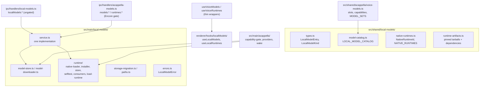

# Local Models

Local Models is the core service that downloads, verifies, stores, and runs models on this
machine: wake word, speech-to-text, text-to-speech, text generation, embeddings, and classifiers.
It is not an Encore Feature and it does not belong to any one feature. Every feature that wants a
local model is a **consumer** of it. A Cappella (voice) is the first consumer; tab naming, AI
command mode, semantic search, the Cue gate, and the prompt-injection screen come later.

The download, verification, and disk rules are unchanged from when the stack lived under voice.
[[model-manager]] states them in full (pinned revisions, hash-before-final-path, resumable
`.part` files, no silent substitution).

## The one rule for consumers

The core knows nothing about which feature asked for a model. A consumer that needs its own words
for a model (a voice slot, a setup bundle, a wake phrase) layers them on top of the core catalog,
keyed by model id, in its own module. The core never grows a field per consumer.

A missing capability is refused by name, never substituted with a different model or provider.
That holds for every consumer, not only voice.

## Module layout



### Shared (`src/shared/local-models/`)

| File                    | Responsibility                                                                                                                 |
| ----------------------- | ------------------------------------------------------------------------------------------------------------------------------ |
| `types.ts`              | `LocalModelEntry`, `LocalModelFile`, `LocalModelKind` (`wake-word`, `stt`, `tts`, `text-gen`, `embedding`, `classifier`)       |
| `model-catalog.ts`      | `LOCAL_MODEL_CATALOG`: id, kind, `runtime`, pinned revision, per-file URL + SHA-256 + size, license; `localModelsForRuntime()` |
| `native-runtimes.ts`    | `NativeRuntimeId` (`llama`, `onnx`), `NATIVE_RUNTIMES`, per-platform prebuild availability                                     |
| `runtime-artifacts.ts`  | The pinned runtime tarballs, their hashes, and every package the payload `require()`s                                          |
| `llama-dependencies.ts` | `node-llama-cpp` 3.20.0 and its 115-package production closure, pinned and hashed, installed beside the llama payload          |
| `tasks.ts`              | `LOCAL_MODEL_TASKS` (the housekeeping jobs), `LocalModelAssignment`, and the `localModelAssignments` reader and validator      |

A model records the runtime it needs (`runtime: NativeRuntimeId`). A runtime never lists features;
a consumer derives its own grouping from the models (voice does this in `voiceSlotsForRuntime()`).

### Main (`src/main/local-models/`)

| File                           | Responsibility                                                                                          |
| ------------------------------ | ------------------------------------------------------------------------------------------------------- |
| `paths.ts`                     | `LOCAL_MODELS_DIRNAME`, `LOCAL_RUNTIMES_DIRNAME`, `localModelsDataDir()`: the only place roots resolve  |
| `model-store.ts`               | Install layout, manifests, `isInstalled`, `verify`, `remove`, `totalFootprint`                          |
| `model-downloader.ts`          | Resumable range downloads, streaming SHA-256, pause/resume/cancel, progress                             |
| `runtime/native-loader.ts`     | Loads a downloaded runtime; refuses with the consumer's download and self-test locations                |
| `runtime/runtime-consumers.ts` | Consumer registry: which runtimes a consumer uses and where its UI lives                                |
| `runtime/load-runtime.ts`      | `loadLocalRuntime()`: the consumer entry point, throws `LocalModelError`                                |
| `runtime/runtime-installer.ts` | Fetches and verifies a runtime tarball and its dependencies                                             |
| `runtime/runtime-store.ts`     | Runtime install layout and footprint                                                                    |
| `runtime/runtime-selftest.ts`  | `runRuntimeSelfTest()` / `formatRuntimeSelfTestLines()`; the llama probe initializes the real backend   |
| `runtime/llama-options.ts`     | `LLAMA_GET_OPTIONS` (never compile from source) and `llamaBackendLabel()`, shared by every `getLlama()` |
| `text-gen.ts`                  | `generateText()` for a local model or an endpoint; the one shared, idle-unloading `LocalTextEngine`     |
| `task-router.ts`               | `runLocalTask()`: a task's assignment decides off / Utility Agent / model; records `local_model_runs`   |
| `endpoint-service.ts`          | Endpoint calls with persisted state: saved list, key from `shellEnvVars`, exact-id `chat...()`          |
| `errors.ts`                    | `LocalModelError` with a stable `code`, a user-facing `recovery`, and the `consumerId`                  |
| `service.ts`                   | The one implementation behind both IPC surfaces (list, download, pause, verify, remove, install, ...)   |
| `storage-migration.ts`         | One-time move of the legacy `acappella/` roots (below)                                                  |

### IPC and renderer

- `src/main/ipc/handlers/local-models.ts` registers `localModels:{list,download,pause,resume,cancel,verify,remove,remove-all,footprint}`
  and `localModels:runtimes:{list,install,footprint,remove-all}`, plus `localModels:runTask` (the
  task router) and `localModels:endpoints:*`, broadcasting on
  `localModels:progress` and `localModels:runtimes:progress`. It is **not** gated by the A Cappella
  Encore flag. It is wired in `setupIpcHandlers()`.
- Preload: `window.maestro.localModels` (with a `.runtimes` sub-namespace), in
  `src/main/preload/localModels.ts`, typed as `LocalModelsApi`.
- Renderer: `useLocalModels()` and `useLocalRuntimes()` in `src/renderer/hooks/localModels/` own the
  one progress/download state machine. They accept a `source`, so a consumer can point them at its
  own (gated) namespace.

## Storage paths

```
userData/models/<model-id>/      manifest.json + the model's files
userData/runtimes/<runtime-id>/  an installed native runtime
```

Both roots resolve through `paths.ts`. `model-store.removeAll()` deletes the whole models root;
every catalog model today is one voice uses, so that is correct for now. It must be scoped per
consumer once a model ships that only another consumer needs.

## Migration from the voice-era layout

Before this service existed, models lived under `userData/models/acappella/` and runtimes under
`userData/runtimes/acappella/`. `migrateLegacyLocalModelStorage()` runs in `src/main/index.ts`
before `setupIpcHandlers()`, so it runs before any store read and whether or not A Cappella is
enabled. For each legacy root it:

1. Renames every entry (directories, `.part` and `.staging` leftovers) up one level.
2. Skips, and logs, any entry whose target already exists. The legacy copy is left alone.
3. Removes the legacy root with `rmdir` only when it is empty.

It never deletes model bytes, tolerates a tree a crash left half moved, and is idempotent. A
failure is reported to Sentry and startup continues. A leftover legacy root appears as a stray
`acappella` entry in the footprint and stays reclaimable.

## A Cappella as a consumer

A Cappella keeps everything that is about voice and imports everything that is about models:

- `src/shared/acappella/voice-models.ts`: capability tags, `voiceSlotsForRuntime()`,
  `runtimesForSlot()`, `MODEL_SETS` (the `hands-free-local` bundle), and wake phrases, all keyed by
  core model id.
- `src/main/acappella/models/capability-gate.ts`: voice readiness, reading the core model store.
- `src/main/acappella/providers/local/runtime.ts`: `loadVoiceRuntime()`, a thin adapter that maps
  `LocalModelError` to `VoiceProviderError`. Parakeet, Whisper, Kokoro, `llama-brain.ts`, and the
  openWakeWord detector load runtimes through it and read model files from the core store.
- `llama-brain.ts` does not own a model. It runs each turn on the shared `LocalTextEngine`
  (`text-gen.ts`), so voice and housekeeping tasks reuse one resident model; its `unload()` frees
  the model only when Qwen3 is the resident one.
- `src/main/acappella/runtime-consumer.ts`: registers voice with the runtime consumer registry at
  startup.
- `src/main/ipc/handlers/acappella-models.ts`: the legacy `models:*` / `runtimes:*` channels. They
  delegate every call to `service.ts` and add only the Encore gate, readiness, and voice `slots`.
  `models:remove-all` and `models:footprint` pass `isVoiceReclaimableModelDir`, so reclaiming
  voice's disk deletes voice models and orphaned directories but spares models another consumer
  runs (embeddings, the injection classifier).
- `useVoiceModels()` / `useVoiceRuntimes()`: thin wrappers over the core hooks.

## The llama runtime layout

The `llama` download is the `@node-llama-cpp/<platform>` binary plus `node-llama-cpp`'s whole
JavaScript closure (`llama-dependencies.ts`), installed under `userData/runtimes/llama/` exactly as
`npm install` would lay it out. The entry point is `node_modules/node-llama-cpp/dist/index.js`; the
payload goes to `node_modules/@node-llama-cpp/<platform>/` so `node-llama-cpp`'s own
`import('@node-llama-cpp/<platform>')` resolves it. Dependencies can carry a nested `installPath`
(npm's un-hoisted copies) and a `keep` list (only `node-llama-cpp` uses one, to drop the 33 MB
llama.cpp source bundle). A manifest whose entry or binary path no longer matches the artifact is
stale, so an install made before this layout is re-downloaded rather than loaded. How the closure
was resolved and what was left out (optional `@reflink/reflink`, the `postinstall` script) is
written at the top of `llama-dependencies.ts`; see [[packaging-notes]] for the background.

Every `getLlama()` call passes `LLAMA_GET_OPTIONS` (`runtime/llama-options.ts`):
`build: 'never'` and `skipDownload: true`. Outside Electron node-llama-cpp defaults to
`build: 'auto'`, which answers a prebuilt binary that fails to load by fetching llama.cpp and
compiling it with cmake. The download already carries the prebuilt for this platform, so a binary
that does not load is reported as a named failure instead.

## Llama runtime on real hardware

Importing `node-llama-cpp` proves only the JavaScript half. The `llama` self-test probe therefore
calls `getLlama()` (which dlopens the platform binary and initializes the compute backend), reports
the backend (`Metal`, `CUDA`, `Vulkan`, or `CPU`, plus `local build` when it was not the prebuilt),
and disposes it. It still loads no model.

The on-device check is `src/__tests__/main/local-models/llama-e2e.test.ts`, skipped unless
`MAESTRO_LOCAL_MODEL_E2E=1`:

```bash
MAESTRO_LOCAL_MODEL_E2E=1 env -u MAESTRO_USER_DATA npx vitest run src/__tests__/main/local-models/llama-e2e.test.ts
```

It installs the `llama` runtime and `qwen3-1.7b-instruct-q4km` through `service.ts` into a scratch
data dir (`$TMPDIR/maestro-local-model-e2e`, kept between runs; override with
`MAESTRO_LOCAL_MODEL_E2E_DIR`), runs the real self-test, routes two utterances through
`LlamaBrainProvider.route()` with the JSON-schema grammar, then drives node-llama-cpp directly to
measure throughput. Results are written to `llama-e2e-results.json` in that dir. vitest's module VM
cannot run the loader's `new Function` import, so the test swaps in a plain `import()` via
`__setNativeImporter`; the entry path and its file-URL conversion are the same.

### Result: 2026-10-10, darwin-arm64 (Apple Silicon, 128 GB unified memory)

| Measurement                             | Value                                                               |
| --------------------------------------- | ------------------------------------------------------------------- |
| Runtime install (41.4 MB, 117 tarballs) | 6.9 s, first run                                                    |
| Model download (1.1 GB GGUF)            | 414.5 s, first run, then verified in 0.5 s                          |
| Self-test                               | PASS, `llama.cpp backend: Metal` (prebuilt), 1.6 s cold, 0.2 s warm |
| Model load + 4096-token context         | 0.77 s                                                              |
| Route, cold (load + grammar turn)       | 1.39 s                                                              |
| Route, warm (grammar turn only)         | 0.56 to 0.59 s                                                      |
| Unconstrained generation                | 76 tokens in 0.41 s, about 185 tokens/s                             |
| Memory                                  | RSS +1.49 GB; llama.cpp reports 1.80 GB used (unified memory)       |

**The grammar path works.** Both routed turns came back as schema-valid `RouteDecision`s.

**Routing quality is not proven.** On a two-agent roster (Backend, Frontend), "tell the frontend
agent to fix the navbar padding" and "ask backend to add rate limiting to login" both came back as
`target: "conductor"` with a clarifying question, not routed to the named agent. That is a model or
prompt problem, not a load problem; the provider stays hidden in the picker until it routes an
explicit agent name correctly.

**Bug the run found.** `LlamaBrainProvider` took a context sequence per turn and never gave it back,
so the second turn on a loaded model failed with `No sequences left`. The chat session now passes
`autoDisposeSequence: true`, and the unit-test mock models a one-sequence context so the regression
is caught without hardware.

## Text generation

`generateText({ source, prompt, system?, maxTokens, temperature?, jsonSchema?, signal? })` in
`src/main/local-models/text-gen.ts` is the one call for a few hundred tokens of text. `source` is a
catalog model (`{ type: 'local', modelId }`) or a saved endpoint (`{ type: 'endpoint', endpointId,
model }`). The result shape is the same for both: `text`, `json` (only when a schema was given and
the reply parsed), `source`, sleep-aware `durationMs`, and token counts when known.

| Rule                                    | Why                                                                                                                                                   |
| --------------------------------------- | ----------------------------------------------------------------------------------------------------------------------------------------------------- |
| One resident local model, app-wide      | A GGUF is a gigabyte of RAM. Asking for another model frees the resident one first.                                                                   |
| Loaded lazily, freed after 5 idle min   | Warm within a burst of work, cold between them. The idle clock restarts after every turn.                                                             |
| Turns are serialized                    | The context has one sequence; a parallel second turn would fail with `No sequences left`.                                                             |
| JSON schema becomes a llama.cpp grammar | Compiled once per schema per load. A build without grammar support generates unconstrained.                                                           |
| Endpoints by exact id, enabled only     | An assignment stores the full id; a prefix that later matches two servers must not pick one.                                                          |
| Temperature defaults to 0               | Housekeeping output should be reproducible.                                                                                                           |
| Failures are classified, never swapped  | `LocalModelError` (`model-unsupported`, `model-not-installed`, `runtime-unavailable`, `generation-failed`, `cancelled`) or `LocalModelEndpointError`. |

## Embedding and classifier models

Both kinds run on ONNX Runtime behind a tokenizer (`loadTokenizer()` in `tokenizer.ts`). An entry of
either kind carries a run spec beside its files, and `defineModel` refuses one whose graph or
tokenizer is not in its own file list:

- `embedding`: `modelFile`, `tokenizerDir`, `maxTokens`, `outputName`, `dimensions`, `pooling`
  (`cls`, `mean`, or `graph`), `normalize`, optional `queryPrefix` / `documentPrefix`.
- `classifier`: the same four graph fields plus `labels` (logit order, from `id2label`) and
  `positiveLabel`.

| Model                             | Kind       | Repo (pinned)                                                | Download | Run spec                                                    | License                   |
| --------------------------------- | ---------- | ------------------------------------------------------------ | -------- | ----------------------------------------------------------- | ------------------------- |
| BGE Small (English), default      | embedding  | `Xenova/bge-small-en-v1.5` @ `ea104dac`                      | 35 MB    | 384 dims, `cls` over `last_hidden_state`, 512 tokens        | MIT                       |
| EmbeddingGemma 300M               | embedding  | `onnx-community/embeddinggemma-300m-ONNX` @ `5090578d`       | 219 MB   | 768 dims, `graph` (`sentence_embedding`), 2048 tokens       | Gemma Terms of Use        |
| Llama Prompt Guard 2 22M, default | classifier | `gravitee-io/Llama-Prompt-Guard-2-22M-onnx` @ `da68d0f6`     | 81 MB    | `BENIGN` / `MALICIOUS` over `logits`, 512 tokens            | Llama 4 Community License |
| DeBERTa v3 Prompt Injection v2    | classifier | `protectai/deberta-v3-base-prompt-injection-v2` @ `90c9989b` | 747 MB   | `SAFE` / `INJECTION` over `logits`, 512 tokens, `onnx/` dir | Apache-2.0                |

Notes a consumer must not re-derive:

- **EmbeddingGemma pools inside the graph.** Its `sentence_embedding` output already applies the
  dense projection; mean-pooling `last_hidden_state` would skip it. Its q4 weights live in
  `onnx/model_q4.onnx_data`, opened by relative path, so it installs beside the graph. It is trained
  with task prefixes (`task: search result | query: ` and `title: none | text: `).
- **Prompt Guard comes from a third-party mirror.** Meta's repo is gated; the mirror is trusted only
  because the revision and every hash are pinned. The Llama 4 Community License requires "Built
  with Llama" to be displayed and the notice "Llama 4 is licensed under the Llama 4 Community
  License, Copyright © Meta Platforms, Inc. All Rights Reserved." to travel with it. The user docs
  repeat this.
- Graph input and output names were checked by loading the BGE and Prompt Guard graphs in ONNX
  Runtime: BGE takes `input_ids`, `attention_mask`, `token_type_ids` and returns
  `last_hidden_state`; Prompt Guard takes `input_ids`, `attention_mask` and returns `logits`.
- None of these is part of voice's `hands-free-local` bundle.

## Tasks and assignments

A **task** is a named job (`tab-naming`, `git-drafts`, `semantic-search`, ...), never a model.
`LOCAL_MODEL_TASKS` in `src/shared/local-models/tasks.ts` lists each one with the kind of model it
`needs`, whether it has an existing agent path (`allowsUtilityAgent`), and its `defaultAssignment`.
The user's choice per task is a `LocalModelAssignment`:

| Assignment                                | Meaning                                                                                              |
| ----------------------------------------- | ---------------------------------------------------------------------------------------------------- |
| `{ type: 'off' }`                         | The task does not run.                                                                               |
| `{ type: 'utility-agent' }`               | The task's existing agent path, unchanged (`utilityAgentId` / `utilityModelId`, or the tab's agent). |
| `{ type: 'local', modelId }`              | A catalog model of the needed kind, run on this machine.                                             |
| `{ type: 'endpoint', endpointId, model }` | A model on one of the user's `localModelEndpoints`.                                                  |

The `localModelAssignments` setting is SPARSE: only tasks the user changed are stored, and
`resolveLocalModelAssignment()` falls back to the registry default. Tab naming, summaries, and AI
command mode default to `utility-agent`, so an existing install (including one with `utilityAgentId`
set) behaves exactly as before; every task new with Local Models defaults to `off`. The migration is
`parseLocalModelAssignments()`, run on every load: unknown tasks, malformed entries, and
`utility-agent` on a task without an agent path are dropped back to the default. A model id the
catalog no longer knows is KEPT, so the router can name it as unavailable instead of the task
quietly changing source. Save-time checks (catalog membership, matching kind) are
`localModelAssignmentProblem()`.

## The task router

`runLocalTask(taskId, input)` in `src/main/local-models/task-router.ts` is the one choke point a
housekeeping task calls. It reads the task's assignment and answers:

| Assignment      | Result                                                                                       |
| --------------- | -------------------------------------------------------------------------------------------- |
| `off`           | `{ status: 'off' }`. No model is touched.                                                    |
| `utility-agent` | `{ status: 'use-utility-agent' }`. The CALLER keeps its existing spawn path; none is copied. |
| `local`         | `generateText` on that model: `ok`, or `unavailable` with the classified `code`.             |
| `endpoint`      | `generateText` on that endpoint: `ok`, or `unavailable` with the classified `code`.          |

A caller abort is `cancelled`, not a failure. `unavailable` carries a `reason` that names the model
or endpoint and what to do. **There is no fallback**: an unavailable local model is never swapped for
an endpoint, and the router never reaches for a cloud agent on its own, because that would spend
money or send text somewhere the user did not choose. An unclassified failure is a bug and is
rethrown for Sentry. Only `needs: 'text-gen'` tasks run here; embedding and classifier tasks get
their own entries in phase 04.

Every call that reaches a model is recorded in the stats database as a `local_model_runs` row (stats
migration v15: task, source type, model, endpoint id, start, sleep-aware duration, `ok` / `error` /
`cancelled`, error code, tokens), honoring `statsCollectionEnabled`. A stats write that fails is
reported to Sentry and never fails the task. `off` and `use-utility-agent` record nothing.

Transports: `localModels:runTask` (IPC, `window.maestro.localModels.runTask`) and
`maestro-cli models run <task-id> --input <text>` (WS bridge message `local_models_run_task`) both
call `runLocalTaskRequest()`, which validates the task id and input once. The CLI exits 0 only for
`ok`, printing just the text, so a script's `$(...)` captures text or fails.

## Related

- [[model-manager]] - download, verification, and disk rules, and voice's capability gate.
- [[packaging-notes]] - why each runtime is fetched rather than bundled.
- [[system-overview]] - where the voice consumer plugs these models in.
