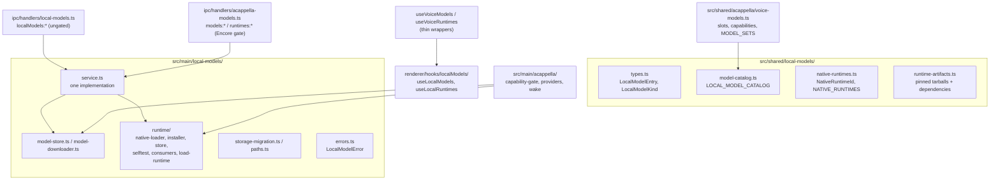

# Local Models

Local Models is the core service that downloads, verifies, stores, and runs models on this
machine: wake word, speech-to-text, text-to-speech, text generation, embeddings, and classifiers.
It is not an Encore Feature and it does not belong to any one feature. Every feature that wants a
local model is a **consumer** of it. A Cappella (voice) is the first consumer; tab naming, AI
command mode, semantic search, the Cue gate, and the prompt-injection screen come later.

The download, verification, and disk rules are unchanged from when the stack lived under voice.
[[model-manager]] states them in full (pinned revisions, hash-before-final-path, resumable
`.part` files, no silent substitution).

## The one rule for consumers

The core knows nothing about which feature asked for a model. A consumer that needs its own words
for a model (a voice slot, a setup bundle, a wake phrase) layers them on top of the core catalog,
keyed by model id, in its own module. The core never grows a field per consumer.

A missing capability is refused by name, never substituted with a different model or provider.
That holds for every consumer, not only voice.

## Module layout



### Shared (`src/shared/local-models/`)

| File                   | Responsibility                                                                                                                 |
| ---------------------- | ------------------------------------------------------------------------------------------------------------------------------ |
| `types.ts`             | `LocalModelEntry`, `LocalModelFile`, `LocalModelKind` (`wake-word`, `stt`, `tts`, `text-gen`, `embedding`, `classifier`)       |
| `model-catalog.ts`     | `LOCAL_MODEL_CATALOG`: id, kind, `runtime`, pinned revision, per-file URL + SHA-256 + size, license; `localModelsForRuntime()` |
| `native-runtimes.ts`   | `NativeRuntimeId` (`llama`, `onnx`), `NATIVE_RUNTIMES`, per-platform prebuild availability                                     |
| `runtime-artifacts.ts` | The pinned runtime tarballs, their hashes, and every package the payload `require()`s                                          |

A model records the runtime it needs (`runtime: NativeRuntimeId`). A runtime never lists features;
a consumer derives its own grouping from the models (voice does this in `voiceSlotsForRuntime()`).

### Main (`src/main/local-models/`)

| File                           | Responsibility                                                                                         |
| ------------------------------ | ------------------------------------------------------------------------------------------------------ |
| `paths.ts`                     | `LOCAL_MODELS_DIRNAME`, `LOCAL_RUNTIMES_DIRNAME`, `localModelsDataDir()`: the only place roots resolve |
| `model-store.ts`               | Install layout, manifests, `isInstalled`, `verify`, `remove`, `totalFootprint`                         |
| `model-downloader.ts`          | Resumable range downloads, streaming SHA-256, pause/resume/cancel, progress                            |
| `runtime/native-loader.ts`     | Loads a downloaded runtime; refuses with the consumer's download and self-test locations               |
| `runtime/runtime-consumers.ts` | Consumer registry: which runtimes a consumer uses and where its UI lives                               |
| `runtime/load-runtime.ts`      | `loadLocalRuntime()`: the consumer entry point, throws `LocalModelError`                               |
| `runtime/runtime-installer.ts` | Fetches and verifies a runtime tarball and its dependencies                                            |
| `runtime/runtime-store.ts`     | Runtime install layout and footprint                                                                   |
| `runtime/runtime-selftest.ts`  | `runRuntimeSelfTest()` / `formatRuntimeSelfTestLines()` (no microphone; voice adds that itself)        |
| `errors.ts`                    | `LocalModelError` with a stable `code`, a user-facing `recovery`, and the `consumerId`                 |
| `service.ts`                   | The one implementation behind both IPC surfaces (list, download, pause, verify, remove, install, ...)  |
| `storage-migration.ts`         | One-time move of the legacy `acappella/` roots (below)                                                 |

### IPC and renderer

- `src/main/ipc/handlers/local-models.ts` registers `localModels:{list,download,pause,resume,cancel,verify,remove,remove-all,footprint}`
  and `localModels:runtimes:{list,install,footprint,remove-all}`, broadcasting on
  `localModels:progress` and `localModels:runtimes:progress`. It is **not** gated by the A Cappella
  Encore flag. It is wired in `setupIpcHandlers()`.
- Preload: `window.maestro.localModels` (with a `.runtimes` sub-namespace), in
  `src/main/preload/localModels.ts`, typed as `LocalModelsApi`.
- Renderer: `useLocalModels()` and `useLocalRuntimes()` in `src/renderer/hooks/localModels/` own the
  one progress/download state machine. They accept a `source`, so a consumer can point them at its
  own (gated) namespace.

## Storage paths

```
userData/models/<model-id>/      manifest.json + the model's files
userData/runtimes/<runtime-id>/  an installed native runtime
```

Both roots resolve through `paths.ts`. `model-store.removeAll()` deletes the whole models root;
every catalog model today is one voice uses, so that is correct for now. It must be scoped per
consumer once a model ships that only another consumer needs.

## Migration from the voice-era layout

Before this service existed, models lived under `userData/models/acappella/` and runtimes under
`userData/runtimes/acappella/`. `migrateLegacyLocalModelStorage()` runs in `src/main/index.ts`
before `setupIpcHandlers()`, so it runs before any store read and whether or not A Cappella is
enabled. For each legacy root it:

1. Renames every entry (directories, `.part` and `.staging` leftovers) up one level.
2. Skips, and logs, any entry whose target already exists. The legacy copy is left alone.
3. Removes the legacy root with `rmdir` only when it is empty.

It never deletes model bytes, tolerates a tree a crash left half moved, and is idempotent. A
failure is reported to Sentry and startup continues. A leftover legacy root appears as a stray
`acappella` entry in the footprint and stays reclaimable.

## A Cappella as a consumer

A Cappella keeps everything that is about voice and imports everything that is about models:

- `src/shared/acappella/voice-models.ts`: capability tags, `voiceSlotsForRuntime()`,
  `runtimesForSlot()`, `MODEL_SETS` (the `hands-free-local` bundle), and wake phrases, all keyed by
  core model id.
- `src/main/acappella/models/capability-gate.ts`: voice readiness, reading the core model store.
- `src/main/acappella/providers/local/runtime.ts`: `loadVoiceRuntime()`, a thin adapter that maps
  `LocalModelError` to `VoiceProviderError`. Parakeet, Whisper, Kokoro, `llama-brain.ts`, and the
  openWakeWord detector load runtimes through it and read model files from the core store.
- `src/main/acappella/runtime-consumer.ts`: registers voice with the runtime consumer registry at
  startup.
- `src/main/ipc/handlers/acappella-models.ts`: the legacy `models:*` / `runtimes:*` channels. They
  delegate every call to `service.ts` and add only the Encore gate, readiness, and voice `slots`.
- `useVoiceModels()` / `useVoiceRuntimes()`: thin wrappers over the core hooks.

## Related

- [[model-manager]] - download, verification, and disk rules, and voice's capability gate.
- [[packaging-notes]] - why each runtime is fetched rather than bundled.
- [[system-overview]] - where the voice consumer plugs these models in.
